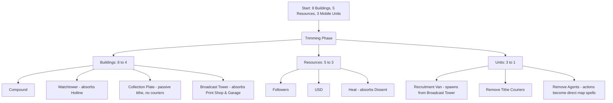

# Flock — Gameplay Features & Simplification Audit

This document compiles every gameplay feature currently implemented in *Flock* (based on the design specifications and codebase). Use this to review which features to keep, merge, simplify, or remove to reach the optimal balance of fun and strategic depth.

---

## 1. Core Conversion & Stance Loop

| Feature | Description | Complexity | Fun Factor | Recommendation |
| :--- | :--- | :---: | :---: | :--- |
| **Spawning / Compounds** | Placing your first compound to anchor territory, spawn agents, and bus in followers. | Low | High | **KEEP** — Essential anchor. |
| **Fronts** | Committing a percentage of your flock to convert adjacent town tiles. | Low | High | **KEEP** — The core active combat mechanic. |
| **Ambient Creep** | Passive, slow conversion pressure applied by owned tiles to adjacent neutral tiles. | Low | High | **KEEP** — Satisfying organic growth. |
| **Stances** | Switching global posture: **Tend** (defense/heal), **Spread** (balanced), or **Crusade** (max pressure). | Low | High | **KEEP** — Clear, macro-level strategic choice. |
| **Milestones & Doctrines** | Earning points at follower thresholds to unlock 1 of 16 permanent upgrades (B.I.T.E. tree). | Med | High | **KEEP** — Provides builds, customization, and progression. |

---

## 2. Resource System

| Resource | Primary Purpose | Complexity | Fun Factor | Recommendation |
| :--- | :--- | :---: | :---: | :--- |
| **Followers** | Your health pool and source of front pressure. Logistic growth model. | Low | High | **KEEP** — The primary health/power score. |
| **USD ($)** | Currency used to place structures, buy land, send vans, and run ops. | Low | High | **KEEP** — The primary economic currency. |
| **Faith** | Used to power rituals and strikes. Drifts passively back to 50. | Low | Med | **SIMPLIFY** — Convert from a persistent 0–100 meter to a simple "cooldown charges" system or keep as a minor currency. |
| **Dissent** | District-level unrest. Spiked by Crusade and Offerings. High dissent causes Schisms. | High | Med | **SIMPLIFY** — District-level tracking is hard to see. Merge with global Heat. |
| **Heat** | Global suspicion. Raised by Crusade and Strikes. High heat triggers CPA pickets/buses. | Med | High | **KEEP** — Creates a fun counter-balance to aggressive play. |

---

## 3. Structures (Buildings)

Currently **8 structures**. Players must manually select tiles to place them.

| Building | Effect | Complexity | Fun Factor | Recommendation |
| :--- | :--- | :---: | :---: | :--- |
| **Compound** | Raises follower cap, respawn point, defensive anchor. | Low | High | **KEEP** |
| **Collection Plate** | Generates income, spawns Tithe Couriers. | Med | High | **SIMPLIFY** — Generate passive income directly; remove physical Courier units. |
| **Watchtower** | 5× defense modifier, reveals agents, alerts of raids. | Low | High | **KEEP** — Core defensive tool. |
| **Broadcast Tower** | Required to launch Propaganda Strikes. | Med | High | **KEEP** — Unlocks late-game power plays. |
| **Hotline Center** | 75% chance to intercept strikes in radius. | Med | Low | **REMOVE** — Make Watchtowers passively intercept strikes instead of requiring a separate reactive building. |
| **Print Shop** | Reduces strike costs and cooldowns in region. | Low | Low | **REMOVE** — Standardize strike costs and cooldowns instead of gating them behind regional buildings. |
| **Garage** | Builds and repairs Recruitment Vans. | Med | Med | **REMOVE** — Let Broadcast Towers or Compounds spawn Vans directly. |
| **Supplement Lab** | Passive income from neighbors (Radiant Path signature). | Low | Med | **KEEP** — Unique faction identity, but make it a standard upgrade rather than a separate building. |

---

## 4. Mobile Units

| Unit | Role | Complexity | Fun Factor | Recommendation |
| :--- | :--- | :---: | :---: | :--- |
| **Recruitment Van** | Mobile converter, robs couriers, only unit allowed in woods. | Med | High | **KEEP** — Highly visible and satisfying mobile pressure. |
| **Tithe Courier** | Automatically travels between plates carrying cash. | High | Med | **REMOVE** — Pathfinding units carrying cash that can be robbed are neat, but require too much micro to protect. |
| **Agent** | Invisible stealth unit used for raids and gathering scandal evidence. | High | Low | **REMOVE** — Micro-managing invisible units on a fast clock is frustrating. Turn raids/scandals into map abilities. |
| **Street Prophet** | Dawn-specific pylon unit (immobile converter). | Low | Med | **KEEP** — Fits the Dawn gameplay style. |
| **CPA minivans/buses** | NPC units that picket fronts and raid compound districts. | Med | High | **KEEP** — Makes high Heat feel active and dangerous. |

---

## 5. Active Operations (Strikes & Ops)

| Action | Effect | Complexity | Fun Factor | Recommendation |
| :--- | :--- | :---: | :---: | :--- |
| **Pamphlet Bomb** | Strike: disables buildings + spikes dissent in target radius. | Med | High | **KEEP** — Great strategic tool to break turtling players. |
| **Prime-Time Exposé** | Strike: halves retention + drains Faith in target radius. | Med | High | **KEEP** |
| **Manifesto Drop** | Doomsday Strike: map-wide strike zones; sets attacker Heat to 100. | Med | High | **KEEP** |
| **Deprogramming Raid** | Turns target area back to Apostate/Neutral. | Med | High | **KEEP** — But trigger it as a direct map action rather than routing an Agent. |
| **Scandal Exposure** | Gather evidence on compounds, publish to wipe out enemy followers. | High | High | **KEEP** — Excellent narrative flavor; convert from Agent-action to compound-channel. |
| **Court Defection** | Pay USD to turn high-dissent enemy districts back to neutral. | Med | Low | **REMOVE** — Hard to track district dissent; standard combat fronts are cleaner. |

---

## 6. Rituals (Faith Cooldowns)

| Ritual | Effect | Complexity | Fun Factor | Recommendation |
| :--- | :--- | :---: | :---: | :--- |
| **Sermon** | Free conversion buff and Faith generator (needs Tend/Spread). | Low | High | **KEEP** — Active conversion tempo button. |
| **Midnight Festival** | Spawns a recruiting aura that speeds up neutral capture. | Low | High | **KEEP** |
| **The Offering** | Sacrifice followers for a quick Faith surge. | Low | Med | **KEEP** — Simple risk/reward tradeoff. |
| **Day of Atonement** | Freezes fronts to speed up dissent recovery. | Low | Low | **REMOVE** — Freezing your own fronts feels bad to play. |

---

## 7. Conflict & Diplomacy (Drama Systems)

| Feature | Effect | Complexity | Fun Factor | Recommendation |
| :--- | :--- | :---: | :---: | :--- |
| **Alliances** | Shared vision, truces, and ecumenical pacts. | High | High | **KEEP** — Core multiplayer diplomacy. |
| **Betrayal** | Attacking allies triggers a traitor icon and massive stats debuff. | Low | High | **KEEP** — The risk/reward of double-crossing is very fun. |
| **Schisms** | High-dissent regions secede as splinters offered to dead players. | High | High | **KEEP** — A signature rubber-banding mechanic, but simplify triggers to global Heat/Dissent. |
| **Landmarks** | Control points (Radio Tower, Megachurch, Town Hall). | Low | High | **KEEP** — Forces conflict map-wide. |

---

## 8. Win Conditions

| Mode | Trigger | Complexity | Fun Factor | Recommendation |
| :--- | :--- | :---: | :---: | :--- |
| **Domination** | Control 72% (S/M maps) or 80% (L maps) of the town. | Low | High | **KEEP** — Primary territory victory. |
| **Doctrinal** | Hold 100 Faith for 90s, then channel at the Megachurch landmark. | Med | High | **KEEP** — Excellent alternative to raw conquest. |
| **Economic** | Bank target USD amount (Prosperity Circle only). | Low | Med | **KEEP** — Fits the MLM theme perfectly. |

---

## Proposed Simplification Roadmap: "The Clean Cut"

If you decide to streamline the game for optimal strategy and fun, here is the suggested pruning map:

