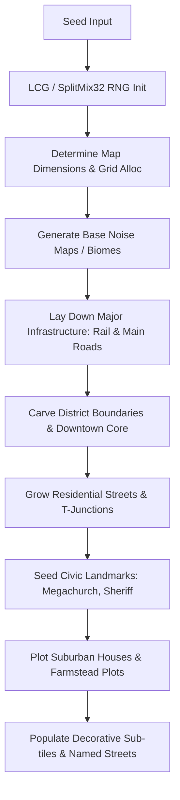

# FLOCK — Map Generation & Procedural World Spec (Extended)

This document details all aspects of the procedural map generation engine (`@flock/sim/src/mapgen.ts` and rendering routines in `townRender.ts`). It outlines the generation pipeline, biome distribution, road networks, landmarks, and structural constraints, offering extensive context for researching upgrades.

---

## 1. Core Architecture & Philosophy

The map generator is designed around three core constraints dictated by FLOCK's market position:
1. **Strict Determinism for Multiplayer**: Given the exact same `seed` integer, the generator must produce identical tile grids, street layouts, and landmark placements. This enables lockstep multiplayer sync (where only player inputs are sent over the network) and ultra-lightweight serverless match replays. If the RNG drifts even by one step between client and server, the game desyncs.
2. **No Orphan Households**: Every house, building, and parcel must have contiguous street access (roads, lanes, or footpaths). This constraint ensures that pathfinding entities (Couriers, Agents, Recruitment Vans) can reach every destination without becoming indefinitely stuck in closed loops.
3. **10-Second Time-to-Fun**: The town layout must be immediately readable without a map menu. The town center (downtown core) is surrounded concentrically by residential streets, transitioning into farmsteads and open wilderness at the map borders. Players should instantly know where to drop their compounds (outskirts) and where to push their conversion fronts (inward).

---

## 2. The Generation Pipeline in Detail

### 2.1 Seed-Based Random Number Generator
Generation uses a custom PRNG (Pseudorandom Number Generator)—often an LCG (Linear Congruential Generator) or a SplitMix32 variant configured in `sim.ts`.
*   **Why not `Math.random()`?** `Math.random()` cannot be seeded and varies by V8 engine implementation. A custom PRNG guarantees that random choices (terrain shape, street directions, house count) are identically resolved across Node.js servers and PixiJS web clients.
*   **Improvement Vector:** Current PRNG algorithms are fast but sometimes exhibit localized clustering. Researching **Xoroshiro128+** or **PCG (Permuted Congruential Generator)** could provide better statistical distribution without sacrificing performance, potentially smoothing out awkward road clusters.

---

## 3. Biomes & Terrain Layout Algorithms

The grid relies on cellular automata or stacked Perlin/Simplex noise to define base terrain.

### 3.1 Biome Distribution & Noise Thresholding
1. **Downtown Core (Asphalt/Brick)**: Generated as a dense rectangular or Voronoi-based centroid near the map's center. Adjacent shops are separated by vertical division seams rather than gaps.
2. **Residential Blocks (Grass/Sidewalks)**: Grow organically outward from the core. High density of picket fences and small homes.
3. **Farmsteads**: Large geometric plots containing specific assemblies (farmhouse, barn, silo, greenhouse) enclosed by pasture fences.
4. **Industrial Zone (Gravel/Scrap)**: Seeded strictly adjacent to the railway. Uses a high-frequency noise map to scatter barrels, crates, and junk tires.
5. **Wilderness (Desert/Forest/Open Field)**: The default backdrop. These are the "blank canvas" parcels where players establish their cult Compounds.

### 3.2 Seasonal Variations & Lighting (Time of Day)
The client reads the match seed to apply deterministic environmental rendering:
*   **Spring**: Lush green tiles with flower sprite overlays.
*   **Summer**: High contrast greens and stark daylight shading.
*   **Fall (Autumn)**: Muted orange, brown foliage, with a pixel-grained forest floor overlay.
*   **Winter**: Frost-tinged ground tiles. *Crucial design constraint:* Snow must be balanced to off-white or gray so that high-contrast glare does not blind players during night cycles.
*   **Lighting Pass**: Blends colored filters across the canvas.
    * `Dawn`: Pink/orange directional tint.
    * `Day`: Neutral.
    * `Dusk`: Warm, long-cast shadow tint.
    * `Night`: Deep blue/purple global illumination mask, which highlights localized light sources (streetlamps, compound floodlights).

*   **Improvement Vector:** Current noise algorithms (if using simple thresholding) create blocky biome transitions. Researching **Domain Warping** or **Wave Function Collapse (WFC)** could produce organic coastlines and smoother transitions between forests and plains.

---

## 4. Road Networks & Infrastructure

### 4.1 Orthogonal Grid Engine
*   **Strict Orthogonality**: Roads only travel N, S, E, W. Diagonal streets introduce severe complexities in pathfinding meshes and Sprite sorting.
*   **Connectivity Logic**: The road generator ensures there are no orphan pixels. Intersections must form T-junctions or Cross-junctions.
*   **Rendering**: Road center lines and sidewalk curbs are drawn dynamically based on neighbor connections (a bitmask auto-tiling approach), ensuring perfect alignment at intersections.

### 4.2 Railroad, Depot & Elevator
*   Every map injects a dominant railroad line crossing the grid (usually near the industrial zone).
*   A procedural rail siding branches to a grain elevator and a cargo depot, featuring connection rail switches drawn dynamically at track junctions.

*   **Improvement Vector:** Current road growth is often random-walk or L-system based, which can create overly chaotic cul-de-sacs. Researching **Tensor Fields for Street Generation** or constrained **Minimum Spanning Trees (MST)** could yield highly realistic, city-planner-grade grid layouts.

---

## 5. Civics & Landmark Placement Constraints

Landmarks are focal points for player strategy and require strict placement rules:
1. **Megachurch**: The ultimate win-condition point. Must be placed precisely in the Downtown Core. Must have radial road access to accommodate heavy agent traffic.
2. **Sheriff's Station**: A civic landmark that generates a local heat-cooling effect (police presence). Usually placed along major transit arteries, avoiding the absolute center.
3. **Player Compounds**: Seeded at equidistant locations on open country parcels near the map edges, ensuring fair travel times to the center for all competing players.

---

## 6. Advanced Research Directions & Upgrade Vectors

To push FLOCK's map generation to the next level, investigate the following algorithmic improvements:

### 6.1 Waterways & Dynamic Bridges
*   **Concept**: Add procedural rivers that divide districts.
*   **Algorithms to Research**: Use 1D Perlin Noise applied to a meandering curve (River Meander algorithms), or simulated water erosion particles over the grid.
*   **Implementation Needs**: 
    *   Bridge auto-tiling.
    *   Pathfinding weight updates (Vans and Couriers must bottleneck at bridges).

### 6.2 Elevation, Cliffs, & Line-of-Sight
*   **Concept**: Introduce topological height (hills, valleys, cliffs).
*   **Algorithms to Research**: Ridge noise or terraced Simplex noise. 
*   **Implementation Needs**:
    *   Adding a `Z-height` integer to the base grid arrays.
    *   Cliff sprites that visually occlude tiles behind them.
    *   Modifying the Fog-of-War / Line-of-Sight (LoS) Raycaster: Watchtowers on Z=2 should cast sight over Z=1 obstacles, granting a massive strategic advantage.

### 6.3 Wave Function Collapse (WFC) for District Micro-Layouts
*   **Concept**: Ensure flawless visual integration of buildings and clutter.
*   **Algorithms to Research**: Wave Function Collapse (WFC).
*   **Implementation Needs**: Instead of hardcoding "barn goes next to silo," WFC allows you to define adjacency rules (e.g., "Parked Car tile must touch Sidewalk tile"). You can run WFC over smaller 8x8 chunks of the map (like a Farmstead or an Industrial lot) to generate highly detailed, mathematically perfect micro-environments without writing complex `if/else` placement trees.

### 6.4 Decorative Clutter & Decal Layering
*   **Concept**: Inject more non-colliding visual elements to increase immersion.
*   **Implementation Needs**:
    *   Mailboxes, fire hydrants, and trash cans along sidewalks.
    *   Parked cars in parallel-parking grid spots.
    *   Alleyway dumpsters.
    *   Using a deterministic low-frequency scatter function to place these without impacting pathfinding nodes.
