# Map Generation — Visual QA Screenshots Gallery (2026-07-02 15:53)

This gallery displays the screenshots from the visual QA pass. The town and surrounding countryside now feature realistic oases, grey gravel shores, weeping willow gallery trees, electrical substations, agricultural drainage ditches, field shelterbelts, and detailed crop/pasture textures.

---

## 1. Full Map Overviews (LOD 1)

### Seed 11 — Temperate World with Rivers, Lakes, and Biome Pockets
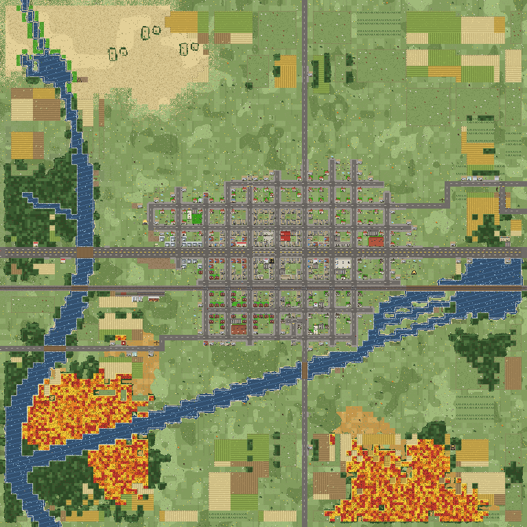

### Seed 21 — Alternate Layout showing Lake Outlet Connectivity
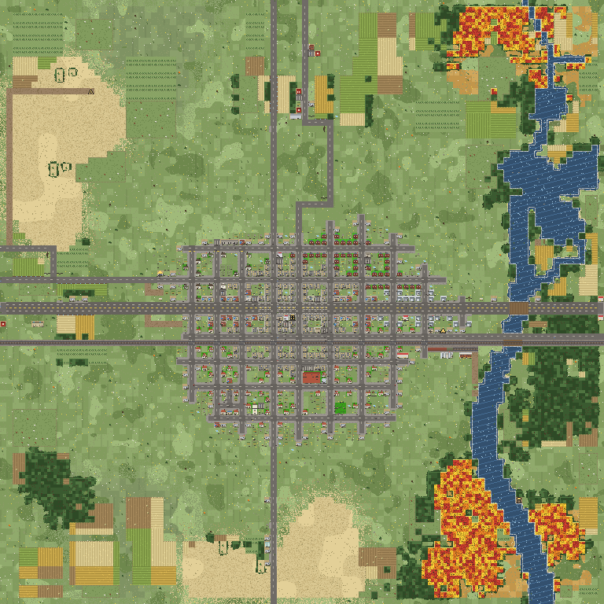

### Seed 42 — High-Density Town Core with Surrounding Farm Belt
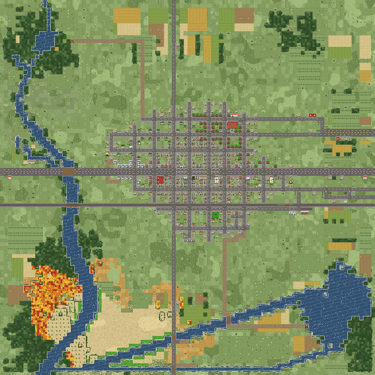

### Seed 77 — Linear Highway Settlement with Siding and Elevators
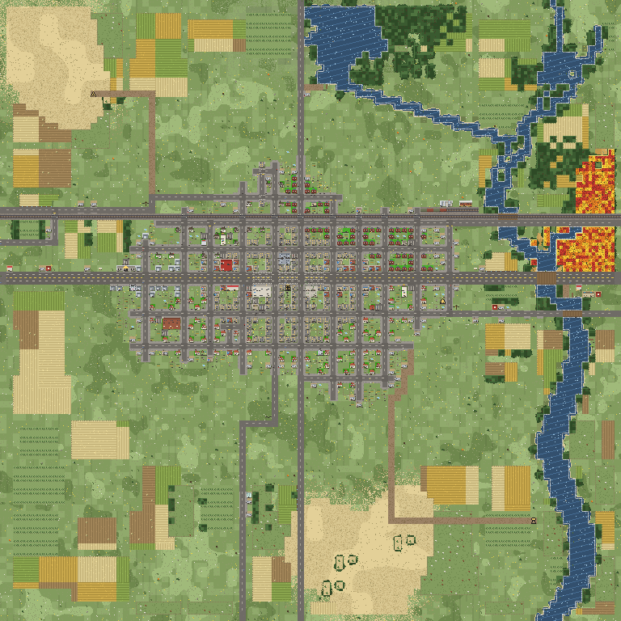

### Seed 99 — Rural Outpost with Meandering Tributaries
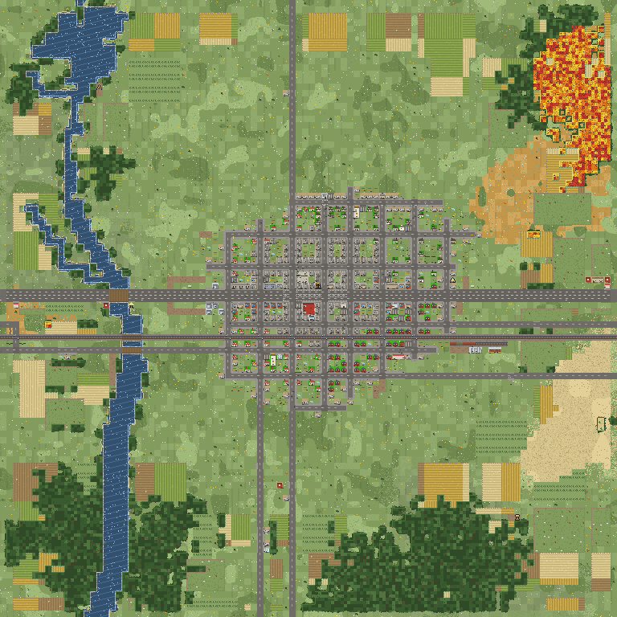

### Seed 11 (Desert Biome Only) — Oasis Margins, Date Palms, and Skulls
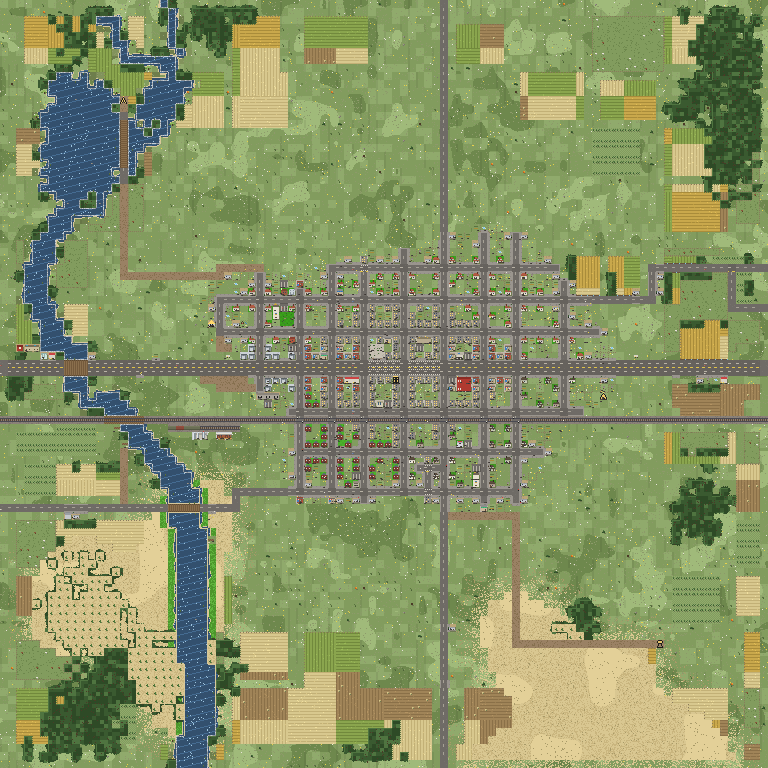

---

## 2. Close Details & Micro-Crops (LOD 3)

### Downtown Core — Gazebo, Diagonal Paths, and Shop Awning Variety
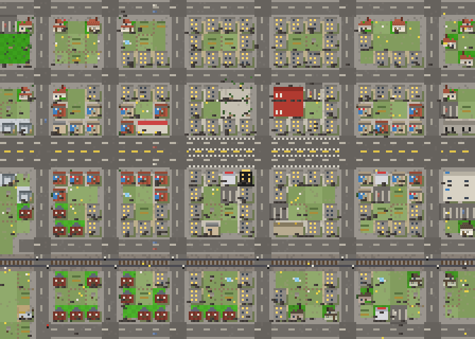

### Main St Strip — Commercial Alleys and Curb Cuts

### Residential Block — Classic Gable, Two-Story, and L-Plan Houses
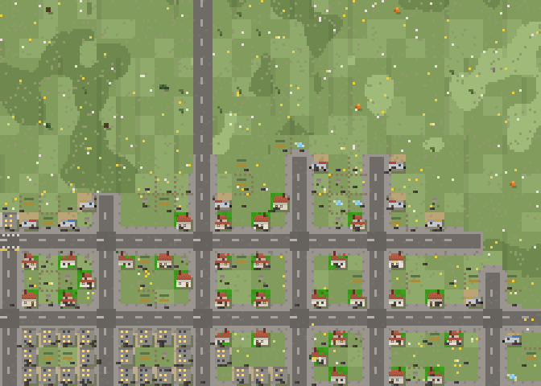

### Industrial Lobe — Fenced Substation, Steel Trusses, and Pallets
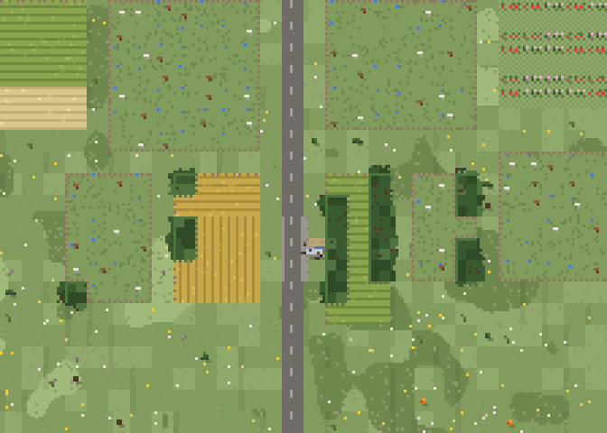

### River Reach Bridge — Grey Gravel Shores and Weeping Willow Trees
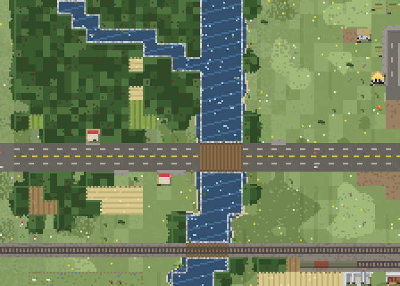

### Lake Shore — Marsh Grasses, Reeds, and Lake Outlets
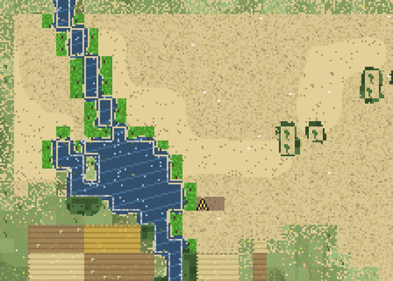

### Farmstead — Orchard Fruits/Blossoms, Pasture Troughs, and Field Ditches
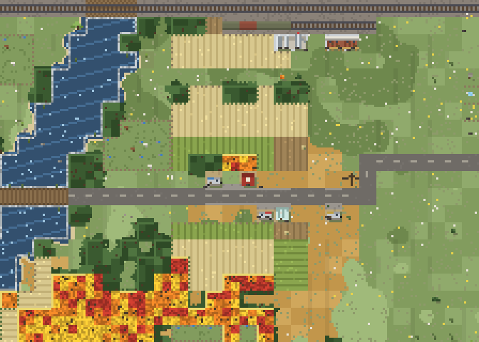

### Desert Ecotone — Saguaro, Blooming Cacti, and Tumbleweeds

### Forest Edge — Mushrooms, Fallen Mossy Logs, and Ferns
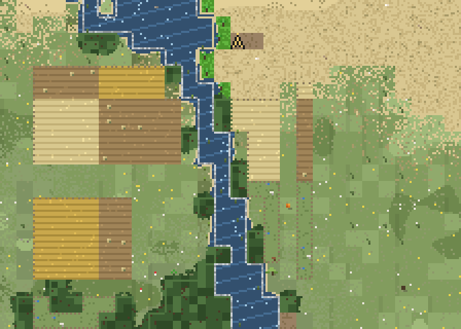
