# Seasonal & Time-Of-Day Visual Showcase (2026-07-02 16:03)

This gallery showcases the newly implemented **Seasonal rendering system** (Spring, Summer, Autumn/Fall, Winter) and **Lighting cycle shifts** (Dawn, Day, Dusk, Night), with the darker lawns, correct seasonal foliage behavior, and clean deserts (no weird green stands or clumped spillover inside the desert).

---

## 1. Seasonal Shifts (LOD 1 Overview)

````carousel
### Spring Day (Fresh Greens + Blossoms)
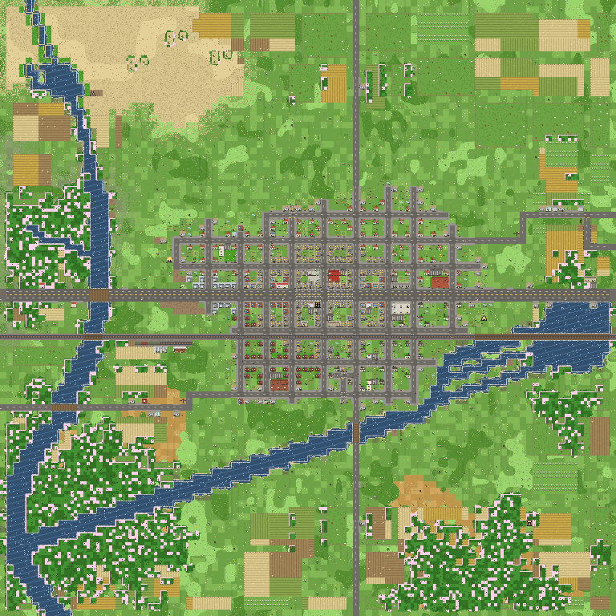
<!-- slide -->
### Summer Day (Lush Warm Meadows & Dark Lawns)
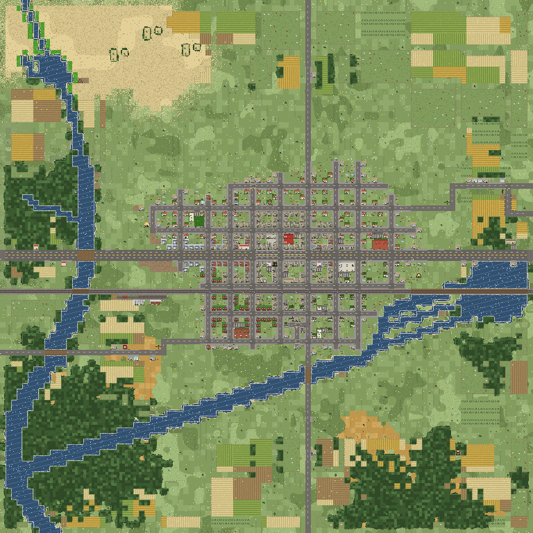
<!-- slide -->
### Autumn Day (Rust/Gold Countryside & Orange/Red Canopies)
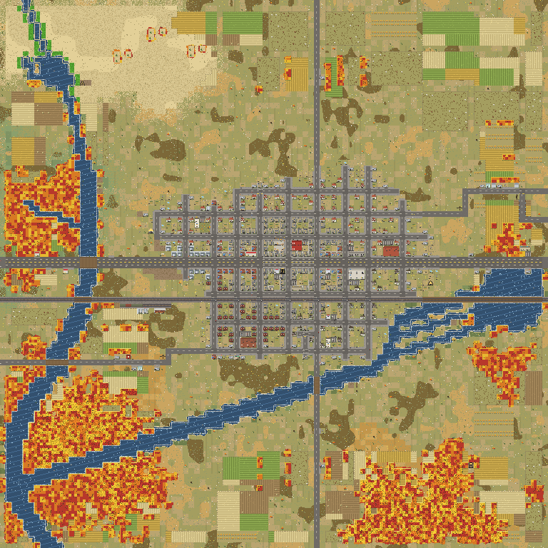
<!-- slide -->
### Winter Day (Snow Cover & Snowy Bare Tree Branches)
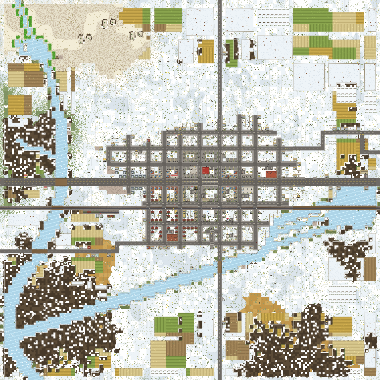
````

---

## 2. Diurnal Cycle (LOD 1 Overview)

````carousel
### Dawn (Warm Rose & Peach Tint)
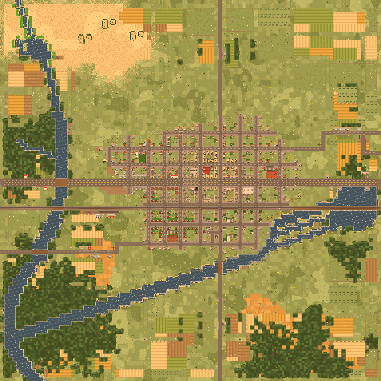
<!-- slide -->
### Day (Standard Palette)

<!-- slide -->
### Dusk (Deep Golden & Purple Twilight)
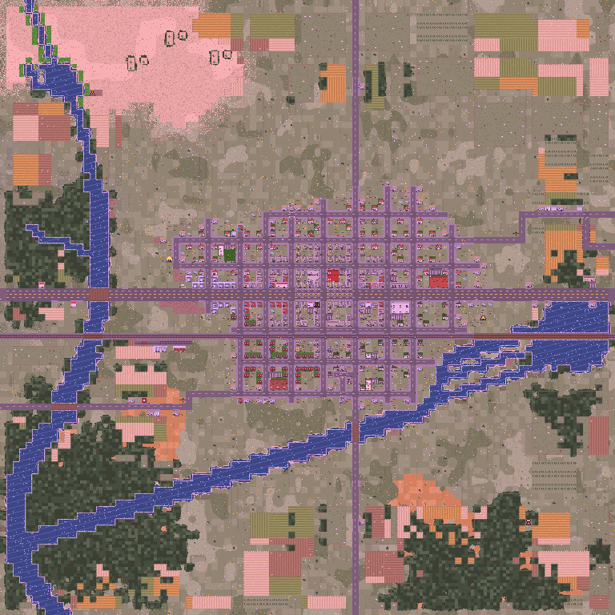
<!-- slide -->
### Night (Cool Moonlit Blue with Glowing Windows & Streetlights)
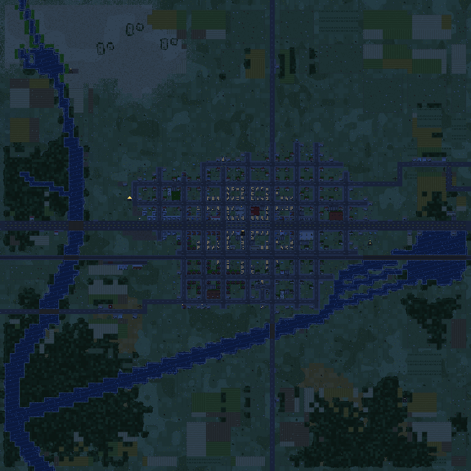
````

---

## 3. Micro-Details: Downtown Core (LOD 3)

````carousel
### Spring (Blossoms & Rich Lawns)
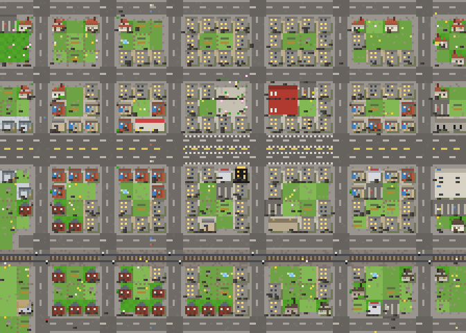
<!-- slide -->
### Summer (Standard Greenery & Dark Lawns)

<!-- slide -->
### Autumn (Orange & Scarlet Foliage)
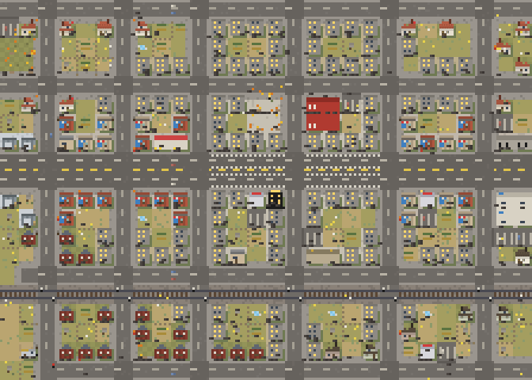
<!-- slide -->
### Winter (Snow Blanket, White Roof Caps & Frozen Water)
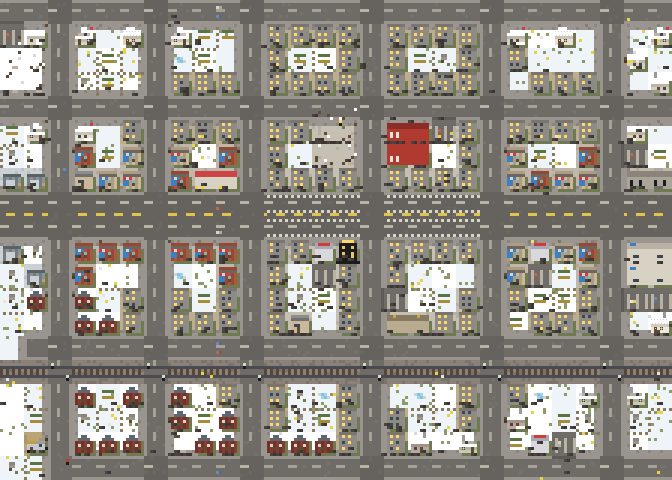
<!-- slide -->
### Summer Night (Glowing Windows & Lit Storefronts)
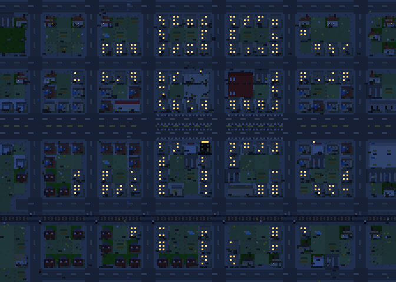
<!-- slide -->
### Winter Night (Glowing Windows in a White Snowscape)
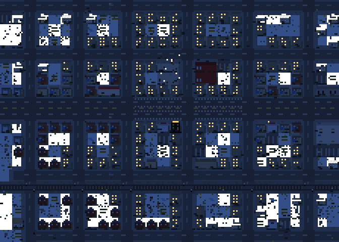
````

---

## 4. Other Standard QA Crops (LOD 3)
* **Main St Strip**: 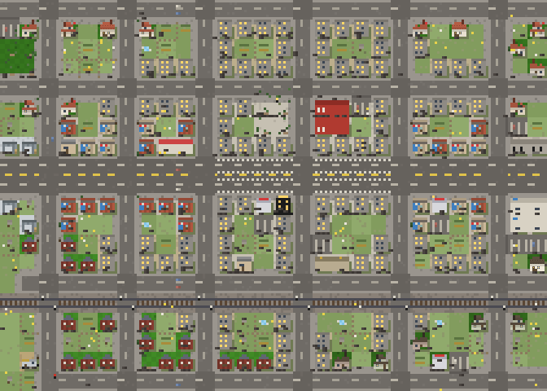
* **Residential Block**: 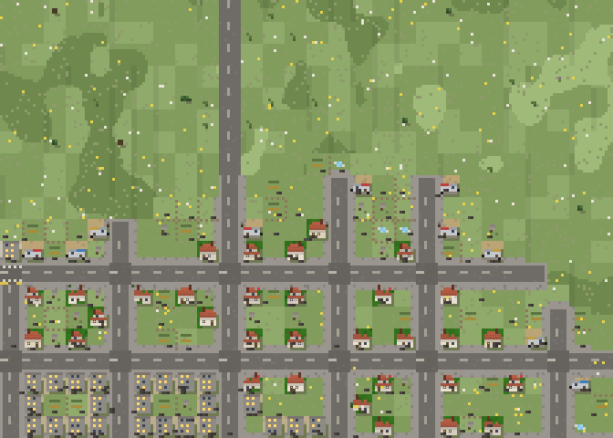
* **Industrial Lobe**: 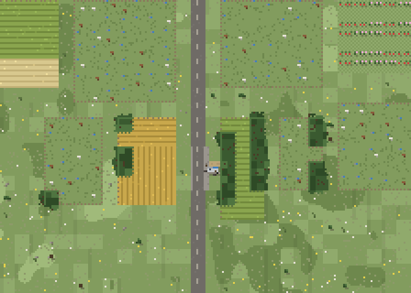
* **River Reach Bridge**: 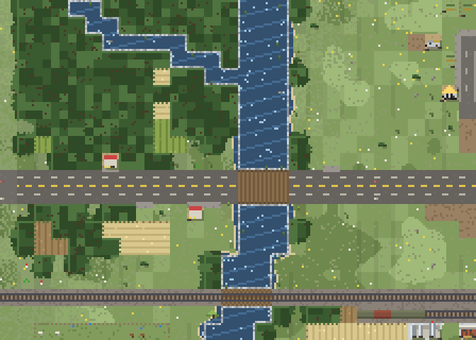
* **Lake Shore**: 
