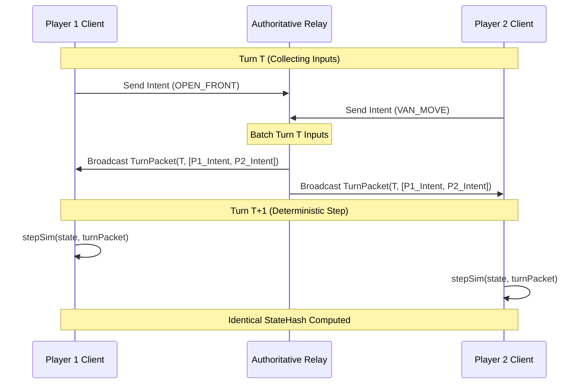

# FLOCK — Core Systems Architecture & Technical Reference

This document outlines the system architecture, component boundaries, networking model, and simulation mechanics of **FLOCK**.

---

## 1. System Topology & Monorepo Structure

FLOCK is organized as an npm workspace monorepo consisting of three tightly decoupled packages:

```mermaid
graph LR
    subgraph Client ["@flock/client (Browser)"]
        UI[HUD & Menus]
        Canvas[PixiJS & Canvas Engine]
        Audio[Web Audio Synth]
        Input[Input & Viewport Controller]
    end

    subgraph Sim ["@flock/sim (Deterministic Core)"]
        Mapgen[Procedural Map Generator]
        SimState[State & Turn Executor]
        TownRender[Pure Pixel Town Renderer]
        BotAI[Faction AI Brains]
        FixedMath[Q16.16 Fixed Point Math]
    end

    subgraph Server ["@flock/server (Node.js)"]
        Relay[WebSocket Lockstep Relay]
        Auth[Auth & Session Service]
        Store[JsonFileStore / DB]
        Matchmaker[Glicko-2 Matchmaker]
    end

    Client -->|Imports Pure Sim| Sim
    Server -->|Imports Pure Sim| Sim
    Client <-->|WebSocket Turns (100ms)| Relay
```

### Package Manifest
* **`@flock/sim`**: Pure TypeScript simulation engine. Zero DOM dependencies, zero Node.js native bindings. Shared bit-identically across client and server.
* **`@flock/server`**: Node.js WebSocket authoritative turn relay, account management, persistent store, and Glicko-2 rating service.
* **`@flock/client`**: Vite-bundled browser application featuring PixiJS canvas rendering, Web Audio synthesis, interactive HUD, and input handlers.

---

## 2. Deterministic Lockstep Simulation Protocol

### 2.1 The 100ms Turn Cycle
* The simulation advances at a fixed rate of **10 ticks per second** (1 tick = 100 ms).
* **Lockstep Transmission**:
  1. During turn $T$, the client collects player intent commands (open front, move van, enact decree, buy parcel).
  2. Intents are dispatched over WebSocket to `@flock/server`.
  3. The server batches all player intents for turn $T$ into a turn packet.
  4. The turn packet is broadcast to all match participants.
  5. At turn $T+1$, every client and server executes the identical intent array against its local `SimState`.



### 2.2 StateHash & Desync Verification
At the end of every simulation tick, `computeStateHash(sim)` generates an integer CRC32 hash across:
* Believer counts, money banks, faith levels, and heat meters.
* Tile ownership, susceptibility arrays, and dissent buffers.
* Building statuses and courier coordinates.

If any client's hash differs from the server's broadcast hash, a desync is detected immediately. Replay verification tests (`test/snapshot.test.ts`) guarantee that saving a state snapshot and loading it yields bit-for-bit identical hashes across 10,000 subsequent ticks.

---

## 3. Data Model & Entity Schemas

### 3.1 Flat Typed Arrays for Scale
To support large maps ($96\times 96$ to $256\times 256$ tiles) with zero garbage collection overhead during live gameplay, world grids are stored as flat typed arrays:

```typescript
export interface World {
  width: number;
  height: number;
  terrain: Uint8Array;    // Terrain enum: Grass, Road, Lake, Woods, Citizen, etc.
  biome: Uint8Array;      // Biome enum: Temperate, Desert, Forest, Autumn, Mountain, Oceanside
  district: Uint8Array;   // District enum: Suburbs, College, Downtown, Old Town, etc.
  lot: Uint8Array;        // Lot enum: Shop, Diner, School, Library, TownHall, Depot, etc.
  pop: Uint16Array;       // Population count per tile
  owner: Uint16Array;     // Owner player ID (NEUTRAL = 0)
}
```

### 3.2 Simulation State (`SimState`)
`SimState` tracks dynamic match state:
* `players: Map<number, PlayerState>`: Money, Faith, Heat, Dissent, Follower caps, Archetype doctrines.
* `fronts: Front[]`: Active conversion pressure lines between territory borders.
* `buildings: Building[]`: Placed cult structures (Chapels, Collection Plates, Radio Antennas, Compound Walls).
* `vans: Van[]`: Recruitment vehicles traveling along road networks.
* `couriers: Courier[]`: Money messengers transporting funds from collection plates to compounds.

---

## 4. Server Architecture & Persistence

* **`AuthService`**: Issues signed JWT session tokens for guest accounts and linked OAuth providers.
* **`JsonFileStore`**: Simple, atomic disk persistence for account progression, unlocked relics, and match histories.
* **`Matchmaker`**: Implements standard Glicko-2 rating calculations ($r, RD, \sigma$).
  * Updates ratings post-match using FFA (Free-For-All) decomposition.
  * Adjusts rating deviations based on player inactivity.
* **Moderation & Safety**: Sanitizes cult names and filters chat using pre-compiled regex wordlists before broadcasting.

---

## 5. Client Architecture & Rendering Pipeline

### 5.1 Hybrid Canvas & PixiJS Pipeline
* **Town Pixel Layer**: Rendered into an `ImageData` / `Uint32Array` pixel buffer via `townRender.ts`. A single blit renders the full town canvas at high frame rates.
* **Sprite & UI Overlay**: PixiJS containers manage dynamic markers, conversion front particle sparks, van sprites, and cursor reticles.
* **Input Controller**:
  * Smooth pan and zoom ($1\times$ to $8\times$).
  * **Drag Threshold Calibration**: Features a calibrated 4-pixel movement deadzone before activating panning, preventing mouse clicks and tile selections from being swallowed during rapid micro-management.

### 5.2 Pure Procedural Web Audio Engine
The audio synthesizer (`packages/client/src/audio/`) generates all sound effects and ambient tracks programmatically using Web Audio API oscillators and gain nodes:
* Church bells, train whistle chimes, collection plate coins, pamphlet drops, and raid alarms.
* Ambient wind noise and environmental soundscapes.
* Zero external MP3/WAV assets required, ensuring instant web loading.
