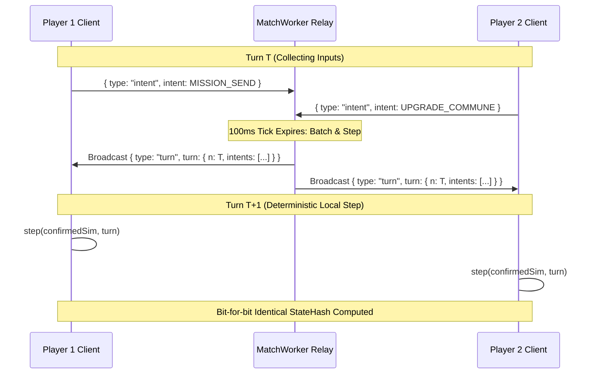
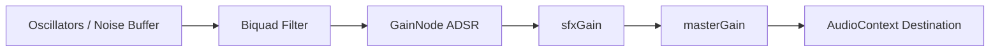

# FLOCK — Core Systems Architecture & Technical Reference

This document outlines the system architecture, component boundaries, networking model, simulation mechanics, and client engine for **FLOCK**.

---

## 1. System Topology & Monorepo Structure

FLOCK is organized as an npm workspace monorepo consisting of three tightly decoupled packages:

```mermaid
graph LR
    subgraph Client ["@flock/client (Browser)"]
        UI[HUD & Menus DOM]
        Canvas[PixiJS & Town Canvas]
        Audio[Procedural Web Audio Synth]
        Input[Viewport & Drag Deadzone Controller]
        NetClient[Dual-Sim Prediction & Netcode]
    end

    subgraph Sim ["@flock/sim (Deterministic Core)"]
        Mapgen[Procedural Map Generator]
        SimState[State & 10 Hz Lockstep Step]
        TownRender[8px Pure Pixel Town Renderer]
        Cohorts[Mission & Cohort Presence Engine]
        BotAI[Intent-Based AI Brains]
        Ranked[Glicko-2 FFA Rating Engine]
        FixedMath[Q16.16 Fixed-Point Math]
    end

    subgraph Server ["@flock/server (Node.js)"]
        Relay[WebSocket Lockstep Relay (100ms)]
        Lobby[LobbyDirector & MatchWorker]
        Auth[HMAC-SHA256 Session Service]
        Store[JsonFileStore / DB Persistence]
        Mod[Name & Chat Moderation Filter]
    end

    Client -->|Imports Pure Sim| Sim
    Server -->|Imports Pure Sim| Sim
    Client <-->|JSON WebSocket Turns (10 Hz)| Relay
```

### Package Manifest
* **`@flock/sim`**: Pure TypeScript simulation engine. Zero DOM dependencies, zero Node.js native bindings. Shared bit-identically across client and server. Contains deterministic PRNG, flat typed array state, combat, civics, and mapgen.
* **`@flock/server`**: Node.js WebSocket authoritative turn relay, match worker coordinator, persistent store, and Glicko-2 rating engine.
* **`@flock/client`**: Vite-bundled browser application featuring hybrid PixiJS + DOM rendering, procedural Web Audio synthesis, interactive HUD, and dual-sim client prediction.

---

## 2. Deterministic Lockstep Simulation Protocol

### 2.1 The 100ms Turn Cycle
* The simulation advances at a fixed rate of **10 ticks per second** (1 tick = 100 ms), driven by `setInterval(() => this.tick(), 100)`.
* **Lockstep Transmission Protocol**:
  1. During turn $T$, the client collects player intent commands (dispatch cohort, upgrade commune, enact decree, buy property).
  2. Intents are sent over WebSocket as `{ type: "intent", intent: Intent }`.
  3. Server batches all intents received during turn $T$ into an authoritative `Turn` packet:
     ```ts
     interface Turn {
       n: number;          // Simulation tick number
       intents: Intent[];  // Batched player & bot intents
       seedSlice: number;  // Deterministic turn PRNG seed
     }
     ```
  4. Server broadcasts `{ type: "turn", turn }` to all match participants.
  5. At turn $T+1$, every client and server executes `step(sim, turn, balance)` against its local simulation state.



### 2.2 RNG Stream Isolation
The server maintains two completely independent PRNG streams to ensure deterministic replays:
* **`turnRng = seedRng(seed ^ 0x5eed51de)`**: Generates `seedSlice = nextU32(turnRng)` in each `Turn` packet, driving in-game random rolls (e.g. ambient creep tie-breakers).
* **`botRng = seedRng(seed ^ 0xb07b07)`**: Drives server-side bot decision-making. Bots emit standard `Intent` objects pushed into the pending intent queue.

### 2.3 StateHash & Desync Verification
* Every **50 turns (5.0 seconds)**, the server broadcasts `{ type: "hash", tick, hash: hashState(sim) }`.
* Clients compute their local `hashState(sim)`. If a hash divergence is detected, the client issues `{ type: "resync" }`.
* The server immediately responds with an authoritative `{ type: "snapshot", snapshot: toSnapshot(sim), players }`, allowing the client to reconstruct state via `fromSnapshot()` without restarting the match.

---

## 3. Client Architecture & Dual-Sim Prediction

### 3.1 Dual-Sim Architecture (`net.ts`)
The client maintains two distinct simulation instances side-by-side:
1. **`confirmed: SimState`**: The authoritative ground truth. Advanced **only** upon receiving verified server `Turn` broadcasts. Evaluated by `hashState(confirmed)` to verify sync against server checksums.
2. **`session.sim: SimState`**: The rendered simulation reflecting speculative local intent prediction.

### 3.2 Rollback-Free Intent Prediction
* **Idle Fast Path**: When no intents are in flight (`pending.length === 0`), `session.sim = confirmed`. Zero cloning overhead occurs during normal viewing.
* **Speculative Stepping**: When a player issues an intent:
  ```ts
  const predicted = fromSnapshot(toSnapshot(confirmed));
  step(predicted, { n: confirmed.tick, intents: pending.map(p => p.intent), seedSlice: 0 }, balance);
  session.sim = predicted;
  ```
* **Authoritative Reconciliation**: When an authoritative server `Turn` packet arrives:
  1. `step(confirmed, turn, balance)` advances authoritative state.
  2. Aged-out intents (`authoredTick < confirmed.tick`) are pruned from `pending`.
  3. Prediction re-clones from updated `confirmed` and reapplies remaining unconfirmed intents.
  4. Local prediction reconciles smoothly within $\le 100\text{ms}$ with zero rollback visual snapping.

### 3.3 Viewport & Input Controller (`main.ts`)
* **Drag Threshold Deadzone Calibration**: Mouse drag uses a strict **6-pixel Manhattan deadzone** (`|dx| + |dy| > 6`). Movements $\le 6$ px do not activate camera panning, ensuring rapid micro-clicks and tile selections are never accidentally swallowed.
* **Selection Model**: Single-tile, district, and radial menu interaction. **No drag-box selection exists** in the engine.
* **Radial Mission Wheel (`wheel.ts`)**: Left-click or right-click opens a 3-sector SVG wheel:
  * **SPREAD** ($120^\circ$, top): Standard expansion.
  * **CRUSADE** ($120^\circ$, bottom-right): Aggressive holy war front.
  * **TEND** ($120^\circ$, bottom-left): Defensive consolidation & Faith generation.
  * Flock percentage slider ($10\%$ to $90\%$, default $40\%$).

---

## 4. Server Architecture & Persistence

### 4.1 Room & Match Worker Coordination (`lobby.ts`)
* **`LobbyDirector`**: Coordinates private and public matches:
  * Public matchmaking groups up to 4 players per match (`Math.min(4, capacity)`).
  * Private matches use 5-character room codes drawn from non-confusing alphabet `ABCDEFGHJKMNPQRSTUVWXYZ23456789`.
* **Bot Backfill Tiers**:
  * *Drifter*: Casual unaligned cult (cadence $25\text{--}55$ ticks, aggression 0).
  * *Established Church*: Strategic AI with civic targeting and border grudges (cadence $10\text{--}18$ ticks, aggression 2).
  * *Sect*: Seceded splinter factions (cadence $18\text{--}34$ ticks, aggression 1).

### 4.2 Persistence Layer (`store.ts`)
* **`Store` Interface**: Pluggable abstraction for accounts, matches, replays, and congregations.
* **`JsonFileStore`**: Production disk persistence configured via `FLOCK_DATA=<dir>`:
  * `<dir>/accounts.json`: Account records, levels, unlocked relics, Glicko-2 ratings.
  * `<dir>/matches.json`: Completed match outcomes, winner IDs, participant deltas.
  * `<dir>/replays/<matchId>.json`: Replay intent streams (`{ seed, finalHash, turns }`).
  * `<dir>/congregations.json`: Player clans/guilds (tags 2–4 characters, max 50 members).

### 4.3 Authentication & Session Security (`auth.ts`)
* **Stateless HMAC-SHA256 Tokens**:
  $$\text{token} = \text{base64url}(\text{payload}) \mathbin{\Vert} "." \mathbin{\Vert} \text{HMAC-SHA256}(\text{base64url}(\text{payload}),\, \text{secret})$$
* **Constant-Time Verification**: Verifies signatures using `crypto.timingSafeEqual` to prevent timing attacks.
* **Token TTL**: 30 days (`30 * 24 * 3600 * 1000` ms). Secret must be $\ge 16$ characters (`FLOCK_SECRET`).
* **Guest FTUE & Linking**: Frictionless guest creation (`guestLogin`); seamlessly upgraded via `providerLogin` (Google, Discord, Email) while preserving accumulated XP, Relics, and account ID.

### 4.4 Moderation & Safety Guardrails (`moderation.ts`)
* **Normalization**: Leetspeak character mapping (`0` $\to$ `o`, `3` $\to$ `e`, `@` $\to$ `a`, etc.), stripping non-alpha characters, and collapsing repeated runs.
* **Tone Guardrails (§30)**: Names are screened against profanity blocklists and real-world sensitive figures/religions (historical cults, mass casualties, major world faiths). Violations default to "Sect #ID" or "Pilgrim".
* **Chat Masking**: Profane tokens masked with asterisks.
* **Rate Limiting**: Monitored per WebSocket client at **20 intents per second** (`RATE_LIMIT_PER_SEC = 20`) via 1000ms sliding window. HTTP request bodies capped at 64 KB.

---

## 5. Competitive Progression & Ratings

### 5.1 Glicko-2 Rating Engine (`ranked.ts`)
* **Parameters**: Baseline rating $\mu = 1500$, deviation $RD = 350$, volatility $\sigma = 0.06$, system constraint $\tau = 0.5$, scale constant $173.7178$.
* **Free-For-All (FFA) Decomposition**: Decomposes 4-player matches into pairwise comparisons down-weighted by `FFA_WEIGHT = 0.4` ($\le 15$ implicit pairings).
* **Rating Persistence Policy**: Real Glicko-2 ratings are calculated and persisted **only for non-guest human accounts**. Guest accounts see provisional ratings in UI results, but their stored rating is untouched.
* **Tier Bands**:
  * *Acolyte*: $< 1600$
  * *Deacon*: $\ge 1600$
  * *Minister*: $\ge 1800$
  * *Cardinal*: $\ge 2000$
  * *Oracle*: $\ge 2200$
  * *Prophet*: Top 500 players by rating on the leaderboard (`PROPHET_CUT = 500`), flagged via `isProphet = true`.

### 5.2 Progression & Relic Economy (`progression.ts`)
* **Match XP Formula**:
  $$\text{XP} = 40 + (2 \times \text{minutes survived}) + \text{placementBonus} + (\text{firstWinOfDay} \,?\, 100 : 0)$$
  * Placement bonus: 1st place: $+120$; Top 25%: $+60$; Top 50%: $+30$.
* **Level Curve**: $\text{xpToNext}(\text{level}) = \text{round}(200 \times \text{level}^{1.25})$. Ranked mode unlocks at Level 5.
* **Relic Currency**: Awarded post-match (10–30 Relics based on survival and placement). Archetype unlocks cost 1,200 Relics. Relics are strictly earned through gameplay; never sold for real currency.

### 5.3 Daily Prophecy (`daily.ts`)
* Global daily challenge served at `GET /daily` based on day number ($\lfloor\text{Date.now()} / 86{,}400{,}000\rfloor$).
* Reward: 30 Relics. Streak milestones at 7, 30, and 100 days reward unique cosmetic badges.
* 8 challenge templates: *The Trusting Shepherd* (no watchtowers), *The Date Is Set* (fulfill prophecy), *Money Talks* (win with \$500k without Crusade), *Cool Head* (win with Heat < 50), *Standing Room Only* (5,000 followers), *No Judas Here* (win in unbroken alliance), *On the Podium* (top 3), *The Long Game* (win as Radiant).

---

## 6. Procedural Audio Synthesizer (`packages/client/src/audio.ts`)

100% procedural Web Audio API synthesizer. Zero external audio asset files (MP3/WAV), ensuring sub-second browser load times.



* **Final Dawn Theme**: Cathedral pipe organ (4 detuned sawtooth oscillators in D-minor triad: 146.83 Hz, 174.61 Hz, 220.0 Hz, 293.66 Hz) with lowpass sweep $900\text{ Hz} \to 350\text{ Hz}$ and crackling fire ember noise.
* **Radiant Path Theme**: Cascading high pentatonic wind chimes (E6, G6, A6, B6, D7) with exponential ring and an acoustic pan flute sliding from A4 ($440\text{ Hz}$) to C5 ($523.25\text{ Hz}$).
* **Prosperity Circle Theme**: Dual cash register "cha-ching" (triangle downward pitch $2200\text{ Hz} \to 400\text{ Hz}$ + high harmonic sine bells at B6 $1975.53\text{ Hz}$).
* **Visitors' Fellowship Theme**: Theremin portamento sweeping $369.99\text{ Hz} \to 783.99\text{ Hz} \to 554.37\text{ Hz}$ modulated by a 6.5 Hz vibrato LFO + telemetry chirps.
* **Fanfares**: Stately C-major brass fanfare for Civic Decrees; triumphant golden arpeggio for Monopoly Unlocks.

---

## 7. Developer Tooling Harness & Verification Scripts

The codebase provides a comprehensive headless CLI harness in `tools/` that engineers (human or AI) can execute directly via shell commands:

| Tool Script | Category | Purpose & CLI Invocation |
| :--- | :--- | :--- |
| `tools/audit_mapgen.mjs` | Verification | Automated 75-world mapgen invariant linter across 5 archetypes: `node tools/audit_mapgen.mjs [--seeds 50]`. Part of `npm test`. |
| `tools/generate_curated_suite.mjs` | Visual QA | Generates 17 high-res PNG benchmarks in `docs/assets/curated/` across 5 archetypes, 4 seasons, and 4 lighting conditions. |
| `tools/generate_catalog_inspection.mjs` | Visual QA | Dual-view asset inspector rendering studio slate (blank background) and in-situ map crops for all 121 catalog assets. |
| `tools/spritesheet.mjs` | Visual QA | Renders live building, lot, and landmark sprites on an isolated studio canvas (`node tools/spritesheet.mjs [out.png]`). |
| `tools/vehicle_spritesheet.mjs` | Visual QA | Renders vehicle silhouettes, directions, and color palettes. |
| `tools/botleague.mjs` | Balance & Sim | Headless tournament runner simulating 200+ bot-vs-bot matches to verify faction win-rate parity: `node tools/botleague.mjs 200 6 48`. |
| `tools/soak.mjs` | Network & Load | Headless WebSocket stress tester spinning up 20+ clients against `@flock/server` to detect desyncs: `node tools/soak.mjs 20 15`. |
| `tools/mapmetrics.mjs` | Quality Metrics | Computes Shannon entropy of zoning, road connectivity ratios, and parcel distributions: `node tools/mapmetrics.mjs farm 96`. |
| `tools/recapcard.mjs` | Graphics | Generates 1080×1350 post-match social recap cards. |
| `tools/create_animated_town_gif.mjs` | Animation | Assembles multi-frame animated GIFs of living town activity. |
| `tools/playtest_sim.mjs` | Interactive Debug | Headless interactive simulation stepper for debugging state transitions. |
| `tools/xbrowser_determinism.mjs` | Invariance | Verifies bit-identical simulation StateHash across multiple JavaScript runtimes. |

### License to Author Custom Development Tools
Engineers and AI models are **explicitly empowered to author new scripts in `tools/`** (or ephemeral scratch scripts) as development progresses. Building custom profiling scripts, automated characterization harnesses, specialized spritesheet generators, or balancing tournament runners is strongly encouraged whenever it accelerates verification or saves token spend.
