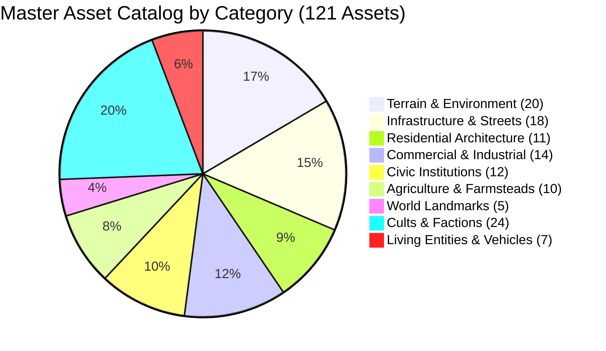

# FLOCK — Master Asset Catalog, Variants & Visual Taxonomy

This document is the authoritative inventory of all environmental, architectural, civic, agricultural, and cult assets in **FLOCK**. Every asset is linked directly to its definition in [`packages/sim/src/assetCatalog.ts`](../packages/sim/src/assetCatalog.ts) and procedural pixel rendering implementation in [`packages/sim/src/townRender.ts`](../packages/sim/src/townRender.ts).

---

## 1. Asset Catalog Index by Category



---

## 2. Category A: Terrain & Environmental Assets (ENV-01 to ENV-20)

| ID | Asset Name | Anim Mode | Frames | 1980s Visual Signature | Variants & Details | Code Links |
| :---: | :--- | :---: | :---: | :--- | :--- | :--- |
| `ENV-01` | **Temperate Grass** | STATIC | 1 | Multi-octave rolling green with light/shadow flecks | Summer vibrant green, Spring pale green, Fall golden rust, Winter snow | [`assetCatalog.ts#L24`](../packages/sim/src/assetCatalog.ts#L24) |
| `ENV-02` | **Rock Outcrops** | STATIC | 1 | 3-px stone clusters on high elevation contours | Granite gray, sandstone tan, lichen green | [`assetCatalog.ts#L33`](../packages/sim/src/assetCatalog.ts#L33) |
| `ENV-03` | **Brush Pockets** | STATIC | 1 | Scrub bush pixels with cast shadows along fence shoulders | Briar patches, sagebrush clumps, wild berry bushes | [`assetCatalog.ts#L42`](../packages/sim/src/assetCatalog.ts#L42) |
| `ENV-04` | **Country Trees** | STATIC | 1 | 2×2 foliage canopy + trunk gap + southeast shadow | 4 species: Spreading Oak, Conical Pine, Birch, Sugar Maple | [`assetCatalog.ts#L51`](../packages/sim/src/assetCatalog.ts#L51) |
| `ENV-05` | **Standing Woods** | STATIC | 1 | Dense clumped canopies with sub-tile edge bleed | Organic multi-tree canopy clumps; sunlit northern fringe | [`assetCatalog.ts#L60`](../packages/sim/src/assetCatalog.ts#L60) |
| `ENV-06` | **River Reach** | ANIMATED_4 | 4 | Deep blue-grey water with surface ripple glints | 4-frame downstream flow glints; gravel and sand shoals | [`assetCatalog.ts#L69`](../packages/sim/src/assetCatalog.ts#L69) |
| `ENV-07` | **Creek Tributaries** | ANIMATED_3 | 3 | Narrow 1-tile channel winding to river | Shallow riparian channels flanked by willows | [`assetCatalog.ts#L78`](../packages/sim/src/assetCatalog.ts#L78) |
| `ENV-08` | **Lake Basin** | ANIMATED_4 | 4 | Wide open water body with drifting glint rows | Deep navy center, shallow turquoise reed margins | [`assetCatalog.ts#L87`](../packages/sim/src/assetCatalog.ts#L87) |
| `ENV-09` | **Desert Dunes** | STATIC | 1 | Warm sand with windward dune crest lines | Arid ochre sand, wind-rippled crest shadows | [`assetCatalog.ts#L96`](../packages/sim/src/assetCatalog.ts#L96) |
| `ENV-10` | **Saguaro Stands** | STATIC | 1 | Vertical green arms with cast shadows | Clustered 2-arm and 4-arm saguaros | [`assetCatalog.ts#L106`](../packages/sim/src/assetCatalog.ts#L106) |
| `ENV-11` | **Desert Dry Wash** | STATIC | 1 | Winding gravel/sand arroyo cutting terrain | Washed stone ridges and dried mud cracks | [`assetCatalog.ts#L114`](../packages/sim/src/assetCatalog.ts#L114) |
| `ENV-12` | **Desert Oasis** | ANIMATED_2 | 2 | Green water pool with date palm canopies | 2-frame water reflection shimmer; date palms | [`assetCatalog.ts#L123`](../packages/sim/src/assetCatalog.ts#L123) |
| `ENV-13` | **Forest Floor** | STATIC | 1 | Damp loam floor, fallen logs, red mushrooms | Deep green/brown loam under dense shade | [`assetCatalog.ts#L132`](../packages/sim/src/assetCatalog.ts#L132) |
| `ENV-14` | **Autumn Foliage** | STATIC | 1 | Warm amber, scarlet, and rust tree canopies | Scarlet red, burnt orange, golden maple mix | [`assetCatalog.ts#L141`](../packages/sim/src/assetCatalog.ts#L141) |
| `ENV-15` | **Riparian Willows** | STATIC | 1 | Drooping pale green canopy over riverbanks | Overhanging branches casting shadows on water | [`assetCatalog.ts#L150`](../packages/sim/src/assetCatalog.ts#L150) |
| `ENV-16` | **Utility Poles** | STATIC | 1 | Wooden telephone poles with crossarms every 3 tiles | Crossarm insulators, sagging wire spans | [`assetCatalog.ts#L159`](../packages/sim/src/assetCatalog.ts#L159) |
| `ENV-17` | **Hedgerows** | STATIC | 1 | Dense brush lines along field boundaries | Thorny blackberry, wild rose, dense privet | [`assetCatalog.ts#L168`](../packages/sim/src/assetCatalog.ts#L168) |
| `ENV-18` | **Shelterbelts** | STATIC | 1 | Linear conifer windbreak rows | 3-to-5 tile pine windbreaks north of farmsteads | [`assetCatalog.ts#L177`](../packages/sim/src/assetCatalog.ts#L177) |
| `ENV-19` | **Stock Tank Pond** | ANIMATED_2 | 2 | Circular pond with mud ring and cattle path | Trampled earth rim, water reflection shimmer | [`assetCatalog.ts#L186`](../packages/sim/src/assetCatalog.ts#L186) |
| `ENV-20` | **Ecotones (3-Ring)**| STATIC | 1 | Graded 3-tile concentric transition bands | Heavy sand $\to$ Scrub $\to$ Meadow grass | [`assetCatalog.ts#L195`](../packages/sim/src/assetCatalog.ts#L195) |

---

## 3. Category B: Infrastructure, Streets & Furniture (ST-01 to ST-18)

| ID | Asset Name | Anim Mode | Frames | 1980s Visual Signature | Placement & Rules | Code Links |
| :---: | :--- | :---: | :---: | :--- | :--- | :--- |
| `ST-01` | **4-Lane Highway** | STATIC | 1 | Dark asphalt with double-yellow center seam | Traverses town; white shoulder lines | [`assetCatalog.ts#L206`](../packages/sim/src/assetCatalog.ts#L206) |
| `ST-02` | **2-Lane Street** | STATIC | 1 | Weathered asphalt with white dash stripes | Flanked by concrete sidewalk skirts | [`assetCatalog.ts#L215`](../packages/sim/src/assetCatalog.ts#L215) |
| `ST-03` | **Cul-de-Sac Bulb** | STATIC | 1 | Circular turnaround terminating a dead-end court | Ringed by residential ranch homes | [`assetCatalog.ts#L224`](../packages/sim/src/assetCatalog.ts#L224) |
| `ST-04` | **Dirt/Gravel Lane** | STATIC | 1 | Mottled two-tone brown rutted track with ditch lines | Connects farmsteads and rural parcels | [`assetCatalog.ts#L233`](../packages/sim/src/assetCatalog.ts#L233) |
| `ST-05` | **Road Bridge** | STATIC | 1 | Timber/stone deck with structural railings | Crosses river channels orthogonally | [`assetCatalog.ts#L242`](../packages/sim/src/assetCatalog.ts#L242) |
| `ST-06` | **Main St Crosswalks** | STATIC | 1 | White zebra stripe road markings | Downtown 4-way and T-intersections | [`assetCatalog.ts#L251`](../packages/sim/src/assetCatalog.ts#L251) |
| `ST-07` | **Traffic Lights** | ANIMATED_3 | 3 | Paired red/green lamp heads on black post | Downtown intersections; 10s cycle | [`assetCatalog.ts#L260`](../packages/sim/src/assetCatalog.ts#L260) |
| `ST-08` | **Stop Signs** | STATIC | 1 | Red octagonal head on metal post | Positioned where side streets meet avenues | [`assetCatalog.ts#L269`](../packages/sim/src/assetCatalog.ts#L269) |
| `ST-09` | **Streetlights** | ANIMATED_2 | 2 | Steel cobra-head streetlight with luminescent head | Night luminous glow bypass | [`assetCatalog.ts#L278`](../packages/sim/src/assetCatalog.ts#L278) |
| `ST-10` | **Railroad Track** | STATIC | 1 | Ballast gravel bed, wood ties, twin steel rails | Orthogonal line crossing map | [`assetCatalog.ts#L287`](../packages/sim/src/assetCatalog.ts#L287) |
| `ST-11` | **Rail Trestle** | STATIC | 1 | Heavy timber framework crossing river | Timber bents supporting rails over water | [`assetCatalog.ts#L296`](../packages/sim/src/assetCatalog.ts#L296) |
| `ST-12` | **Crossbuck Crossing** | ANIMATED_2 | 2 | White X sign with flashing red lamps | Flashes when train approaches street crossing | [`assetCatalog.ts#L305`](../packages/sim/src/assetCatalog.ts#L305) |
| `ST-13` | **Rail Siding Spur** | STATIC | 1 | Secondary track branch serving grain elevator | Parallel to rail line for parked boxcars | [`assetCatalog.ts#L314`](../packages/sim/src/assetCatalog.ts#L314) |
| `ST-14` | **Parked Boxcars** | STATIC | 1 | Rusted boxcars on industrial siding | Clustered by grain elevator | [`assetCatalog.ts#L323`](../packages/sim/src/assetCatalog.ts#L323) |
| `ST-15` | **Highway Billboards** | STATIC | 1 | White ad billboard on twin posts | Positioned on highway approaches | [`assetCatalog.ts#L332`](../packages/sim/src/assetCatalog.ts#L332) |
| `ST-16` | **Welcome Signs** | STATIC | 1 | "Mundane Falls City Limits" wooden board | Flanks Main Street entrances | [`assetCatalog.ts#L341`](../packages/sim/src/assetCatalog.ts#L341) |
| `ST-17` | **Concrete Weirs** | ANIMATED_3 | 3 | Low dam wall across river with water cascade | 3-frame animated cascading foam spray | [`assetCatalog.ts#L350`](../packages/sim/src/assetCatalog.ts#L350) |
| `ST-18` | **Property Stakes** | STATIC | 1 | Dashed colored cord on parcel boundaries | Outlines purchased wilderness land | [`assetCatalog.ts#L359`](../packages/sim/src/assetCatalog.ts#L359) |

---

## 4. Category C: Residential Structures & Neighborhoods (RES-01 to RES-11)

| ID | Asset Name | Anim Mode | Frames | 1980s Visual Signature | Variants & Yard Details | Code Links |
| :---: | :--- | :---: | :---: | :--- | :--- | :--- |
| `RES-01` | **House: Ranch/Long** | STATIC | 1 | 1-story wide facade with attached garage bay | Driveway, parked car, red chimney | [`assetCatalog.ts#L370`](../packages/sim/src/assetCatalog.ts#L370) |
| `RES-02` | **House: Two-Story** | STATIC | 1 | Colonial profile with dormers and gabled roof | Upper window dormers, front flowerbed | [`assetCatalog.ts#L379`](../packages/sim/src/assetCatalog.ts#L379) |
| `RES-03` | **House: Split-Level** | STATIC | 1 | Asymmetrical split-level with side garage | Recessed porch, staggered roofline | [`assetCatalog.ts#L388`](../packages/sim/src/assetCatalog.ts#L388) |
| `RES-04` | **House: Bungalow** | STATIC | 1 | Square cottage with full-width covered veranda | Wood steps, pitched hipped roof | [`assetCatalog.ts#L397`](../packages/sim/src/assetCatalog.ts#L397) |
| `RES-05` | **Trailer Home** | STATIC | 1 | Narrow rectangular metal body with hitch tongue | Propane tank, plastic awning, metal skirting | [`assetCatalog.ts#L406`](../packages/sim/src/assetCatalog.ts#L406) |
| `RES-06` | **Trailer Court** | STATIC | 1 | Dirt court lane with paired trailer rows | Tire piles, scrap metal, gravel parking | [`assetCatalog.ts#L415`](../packages/sim/src/assetCatalog.ts#L415) |
| `RES-07` | **Detached Garage** | STATIC | 1 | Small flat/pitched roof garage on rear lot | Concrete driveway connecting to street | [`assetCatalog.ts#L424`](../packages/sim/src/assetCatalog.ts#L424) |
| `RES-08` | **Backyards** | STATIC | 1 | Block interior garden: shed, clothesline, fence | Chain-link or wooden picket boundary | [`assetCatalog.ts#L433`](../packages/sim/src/assetCatalog.ts#L433) |
| `RES-09` | **Above-Ground Pool** | ANIMATED_2 | 2 | Circular blue pool with white ladder | Water reflection shimmer | [`assetCatalog.ts#L442`](../packages/sim/src/assetCatalog.ts#L442) |
| `RES-10` | **Front Curbside** | STATIC | 1 | Street mailbox post + corner fire hydrant | Sits on grassy sidewalk verge | [`assetCatalog.ts#L451`](../packages/sim/src/assetCatalog.ts#L451) |
| `RES-11` | **Chimney Smoke** | ANIMATED_3 | 3 | Translucent woodsmoke plume drifting southeast | Active on houses during fall/winter | [`assetCatalog.ts#L460`](../packages/sim/src/assetCatalog.ts#L460) |

---

## 5. Category D: Commercial & Industrial Architecture (COM-01 to COM-14)

| ID | Asset Name | Anim Mode | Frames | 1980s Visual Signature | Footprint & Details | Code Links |
| :---: | :--- | :---: | :---: | :--- | :--- | :--- |
| `COM-01` | **Main St Block** | STATIC | 1 | Contiguous attached brick buildings with parapets | 1px vertical party-wall seams, large display glass | [`assetCatalog.ts#L471`](../packages/sim/src/assetCatalog.ts#L471) |
| `COM-02` | **Strip Shop** | STATIC | 1 | Colorful striped fabric awnings (red/blue/green) | Strip retail storefronts with front door | [`assetCatalog.ts#L480`](../packages/sim/src/assetCatalog.ts#L480) |
| `COM-03` | **Roadside Diner** | ANIMATED_2 | 2 | Streamlined chrome body with red neon roof band | 2-frame neon pulse; angled parking apron | [`assetCatalog.ts#L489`](../packages/sim/src/assetCatalog.ts#L489) |
| `COM-04` | **Gas Station** | ANIMATED_2 | 2 | Illuminated canopy over boxy 1980s gas pumps | Corner lot; neon price sign; service bay | [`assetCatalog.ts#L498`](../packages/sim/src/assetCatalog.ts#L498) |
| `COM-05` | **Laundromat** | STATIC | 1 | Glass storefront with circular washer window dots | Tiled interior hint, coin laundry sign | [`assetCatalog.ts#L507`](../packages/sim/src/assetCatalog.ts#L507) |
| `COM-06` | **Cinema / Arcade**| ANIMATED_2 | 2 | Dark facade with illuminated marquee canopy | Chasing marquee bulb frame; movie posters | [`assetCatalog.ts#L516`](../packages/sim/src/assetCatalog.ts#L516) |
| `COM-07` | **Downtown Bank** | STATIC | 1 | Classical limestone facade with column portico | Prominent corner presence | [`assetCatalog.ts#L525`](../packages/sim/src/assetCatalog.ts#L525) |
| `COM-08` | **Post Office** | STATIC | 1 | Red-brick civic structure with blue/red emblem | Rear loading dock for mail vans | [`assetCatalog.ts#L534`](../packages/sim/src/assetCatalog.ts#L534) |
| `COM-09` | **Office Block** | STATIC | 1 | Multi-story concrete/brick block with window grid | Flat gravel roof with HVAC chillers | [`assetCatalog.ts#L543`](../packages/sim/src/assetCatalog.ts#L543) |
| `COM-10` | **Highway Motel** | ANIMATED_2 | 2 | L-shaped motel block with repeating doors | Red neon "VACANCY" sign; parked cars | [`assetCatalog.ts#L552`](../packages/sim/src/assetCatalog.ts#L552) |
| `COM-11` | **Motel Pool** | ANIMATED_2 | 2 | Rectangular blue swimming pool with deck chairs | Water surface shimmer; chain-link fence | [`assetCatalog.ts#L561`](../packages/sim/src/assetCatalog.ts#L561) |
| `COM-12` | **Factory Complex**| ANIMATED_3 | 3 | Sawtooth industrial rooflines with brick smokestack | 3-frame drifting industrial smoke plume | [`assetCatalog.ts#L570`](../packages/sim/src/assetCatalog.ts#L570) |
| `COM-13` | **Warehouse** | STATIC | 1 | Corrugated steel bay with loading docks | Semi-truck bays; gravel staging yard | [`assetCatalog.ts#L579`](../packages/sim/src/assetCatalog.ts#L579) |
| `COM-14` | **Depot Station** | STATIC | 1 | Brick station with quoin trim and platform timber | Platform timber deck, benches, luggage cart | [`assetCatalog.ts#L588`](../packages/sim/src/assetCatalog.ts#L588) |

---

## 6. Category E: Keystone Civic Institutions (CIV-01 to CIV-12)

| ID | Asset Name | Anim Mode | Frames | 1980s Visual Signature | Physical Invariant Rules | Code Links |
| :---: | :--- | :---: | :---: | :--- | :--- | :--- |
| `CIV-01` | **Town Hall** | ANIMATED_2 | 2 | Brick courthouse with stone pediment & cupola | Flutters municipal flag; central square | [`assetCatalog.ts#L599`](../packages/sim/src/assetCatalog.ts#L599) |
| `CIV-02` | **Sheriff's Station**| STATIC | 1 | Tan station with radio mast + 2 police cruisers | Cruiser parking lot with bubble-lights | [`assetCatalog.ts#L608`](../packages/sim/src/assetCatalog.ts#L608) |
| `CIV-03` | **1980s High School**| STATIC | 1 | Low red-brick academic building with ribbon windows | Multiple wings, central entry, bus loop | [`assetCatalog.ts#L617`](../packages/sim/src/assetCatalog.ts#L617) |
| `CIV-04` | **Athletic Stadium**| STATIC | 1 | Football gridiron, running track, bleachers | Adjacent to High School campus | [`assetCatalog.ts#L626`](../packages/sim/src/assetCatalog.ts#L626) |
| `CIV-05` | **Parked School Bus**| STATIC | 1 | Yellow school bus with black rub rails | Parked in school loading lane | [`assetCatalog.ts#L635`](../packages/sim/src/assetCatalog.ts#L635) |
| `CIV-06` | **Elementary School**| STATIC | 1 | Single-story brick school with corner flagpole | Sidewalk connection; parking apron | [`assetCatalog.ts#L644`](../packages/sim/src/assetCatalog.ts#L644) |
| `CIV-07` | **Playground** | STATIC | 1 | Swing set, metal slide, and sand playbox | Located on Elementary School parcel | [`assetCatalog.ts#L653`](../packages/sim/src/assetCatalog.ts#L653) |
| `CIV-08` | **Supermarket** | STATIC | 1 | Wide commercial box with sloped entrance awning | Large parking lot with painted stalls | [`assetCatalog.ts#L662`](../packages/sim/src/assetCatalog.ts#L662) |
| `CIV-09` | **Community Church** | STATIC | 1 | Steepled white nave with stained glass | Paired parsonage house next door | [`assetCatalog.ts#L671`](../packages/sim/src/assetCatalog.ts#L671) |
| `CIV-10` | **Town Cemetery** | STATIC | 1 | Headstone rows with cast shadows on mown grass | Wrought-iron fence; church neighbor | [`assetCatalog.ts#L680`](../packages/sim/src/assetCatalog.ts#L680) |
| `CIV-11` | **Fire Station** | STATIC | 1 | Red-brick station with 2 red overhead bay doors | Concrete vehicle apron; hose drying tower | [`assetCatalog.ts#L689`](../packages/sim/src/assetCatalog.ts#L689) |
| `CIV-12` | **Civic Water Tower**| STATIC | 1 | Municipal sphere on 4-leg braced steel trestle | Graffiti detail; painted town name | [`assetCatalog.ts#L698`](../packages/sim/src/assetCatalog.ts#L698) |

---

## 7. Category F: Agriculture & Farmsteads (AGR-01 to AGR-10)

| ID | Asset Name | Anim Mode | Frames | 1980s Visual Signature | Agricultural Function | Code Links |
| :---: | :--- | :---: | :---: | :--- | :--- | :--- |
| `AGR-01` | **Corn Field** | ANIMATED_2 | 2 | Deep green crop rows with dark soil furrows | Subtle wind sway; $6\times 6$ parcel | [`assetCatalog.ts#L709`](../packages/sim/src/assetCatalog.ts#L709) |
| `AGR-02` | **Wheat Field** | ANIMATED_2 | 2 | Golden amber rows with pale straw shadows | Golden ripple sway | [`assetCatalog.ts#L718`](../packages/sim/src/assetCatalog.ts#L718) |
| `AGR-03` | **Soybean Field** | STATIC | 1 | Verdant lime-green compact leafy rows | Open agricultural belt | [`assetCatalog.ts#L727`](../packages/sim/src/assetCatalog.ts#L727) |
| `AGR-04` | **Fallow Field** | STATIC | 1 | Turned dark brown earth with plow ridges | Contrasts with green pastures | [`assetCatalog.ts#L736`](../packages/sim/src/assetCatalog.ts#L736) |
| `AGR-05` | **Farmstead House**| STATIC | 1 | White two-story farmhouse with wrap-around porch | Anchors agricultural parcel cluster | [`assetCatalog.ts#L745`](../packages/sim/src/assetCatalog.ts#L745) |
| `AGR-06` | **Red Gambrel Barn**| STATIC | 1 | Classic red barn with white X-brace doors | Standing seam roof, hay loft door | [`assetCatalog.ts#L754`](../packages/sim/src/assetCatalog.ts#L754) |
| `AGR-07` | **Silver Grain Silo**| STATIC | 1 | Cylindrical galvanized steel silo with domed cap | Anchored directly against barn | [`assetCatalog.ts#L763`](../packages/sim/src/assetCatalog.ts#L763) |
| `AGR-08` | **Grain Elevator** | ANIMATED_2 | 2 | Towering concrete elevator complex with headhouse | Rail siding anchor; dust drift | [`assetCatalog.ts#L772`](../packages/sim/src/assetCatalog.ts#L772) |
| `AGR-09` | **Pasture Livestock**| ANIMATED_2 | 2 | Grazing dairy cows and chestnut horses | Tail swish and head-bob feeding | [`assetCatalog.ts#L781`](../packages/sim/src/assetCatalog.ts#L781) |
| `AGR-10` | **Farm Tractor** | STATIC | 1 | Parked green/red farm tractor | Sits in gravel farmyard | [`assetCatalog.ts#L790`](../packages/sim/src/assetCatalog.ts#L790) |

---

## 8. Category G: Keystone World Landmarks (LMK-01 to LMK-05)

| ID | Asset Name | Anim Mode | Frames | 1980s Visual Signature | Strategic Objective | Code Links |
| :---: | :--- | :---: | :---: | :--- | :--- | :--- |
| `LMK-01` | **The Old Megachurch** | STATIC | 1 | Massive stone cathedral nave with stained-glass rose window | Primary Revelation win condition (90s hold + 20s channel) | [`assetCatalog.ts#L801`](../packages/sim/src/assetCatalog.ts#L801) |
| `LMK-02` | **AM Radio Tower** | ANIMATED_2 | 2 | Steel lattice transmission mast with guy wires | 2-second breathing red aviation beacon | [`assetCatalog.ts#L810`](../packages/sim/src/assetCatalog.ts#L810) |
| `LMK-03` | **County Fairground** | ANIMATED_4 | 4 | Striped circus pavilions and rotating ferris wheel frame | Pennants flutter; fairground crowd | [`assetCatalog.ts#L819`](../packages/sim/src/assetCatalog.ts#L819) |
| `LMK-04` | **Water Tower** | STATIC | 1 | Spherical steel tank on braced trestle legs | Prominent landscape beacon; graffiti | [`assetCatalog.ts#L828`](../packages/sim/src/assetCatalog.ts#L828) |
| `LMK-05` | **Town Hall Complex** | STATIC | 1 | Classical courthouse block with copper cupola dome | Enacts the 7 Municipal Civic Decrees | [`assetCatalog.ts#L837`](../packages/sim/src/assetCatalog.ts#L837) |

---

## 9. Category H: Cult Headquarters, Vans & Overlays (CLT-01 to CLT-24)

| ID | Cult Asset Name | Faction | Anim Mode | 1980s Visual Signature | Code Links |
| :---: | :--- | :---: | :---: | :--- | :--- |
| `CLT-01` | **Final Dawn Compound** | Dawn | ANIMATED_2 | Fortified survivalist bunker, sandbags, braziers | [`assetCatalog.ts#L848`](../packages/sim/src/assetCatalog.ts#L848) |
| `CLT-02` | **Final Dawn Van** | Dawn | ANIMATED_2 | Matte-black armored ram-van with roof speakers | [`assetCatalog.ts#L857`](../packages/sim/src/assetCatalog.ts#L857) |
| `CLT-03` | **Final Dawn Agent** | Dawn | ANIMATED_4 | Red-hooded stealth figure with 4-frame sneaking cycle | [`assetCatalog.ts#L866`](../packages/sim/src/assetCatalog.ts#L866) |
| `CLT-04` | **Dawn Prophet Pylon** | Dawn | ANIMATED_3 | Cast-iron brazier pylon with crackling animated fire | [`assetCatalog.ts#L875`](../packages/sim/src/assetCatalog.ts#L875) |
| `CLT-05` | **Dawn Territory Overlay** | Dawn | ANIMATED_2 | Obsidian ground with pulsing crimson ember veins | [`assetCatalog.ts#L884`](../packages/sim/src/assetCatalog.ts#L884) |
| `CLT-06` | **Dawn Conquered Lot** | Dawn | STATIC | Barbed-wire perimeters and bonfire ash pits | [`assetCatalog.ts#L893`](../packages/sim/src/assetCatalog.ts#L893) |
| `CLT-07` | **Radiant Path Compound** | Radiant | ANIMATED_2 | Geodesic glass dome with crystal spire and prism glints | [`assetCatalog.ts#L902`](../packages/sim/src/assetCatalog.ts#L902) |
| `CLT-08` | **Radiant Path Van** | Radiant | ANIMATED_2 | Aerodynamic cream/sage camper van with rolling wheels | [`assetCatalog.ts#L911`](../packages/sim/src/assetCatalog.ts#L911) |
| `CLT-09` | **Radiant Path Agent** | Radiant | ANIMATED_4 | Barefoot robed figure with fluid linen walk cycle | [`assetCatalog.ts#L920`](../packages/sim/src/assetCatalog.ts#L920) |
| `CLT-10` | **Radiant Supplement Lab** | Radiant | ANIMATED_2 | Octagonal pavilion with bubbling distillation coils | [`assetCatalog.ts#L929`](../packages/sim/src/assetCatalog.ts#L929) |
| `CLT-11` | **Radiant Territory** | Radiant | STATIC | Soft watercolor gradient bloom with lavender speckles | [`assetCatalog.ts#L938`](../packages/sim/src/assetCatalog.ts#L938) |
| `CLT-12` | **Radiant Conquered Lot** | Radiant | STATIC | Botanical pergola canopies and Zen raked gravel | [`assetCatalog.ts#L947`](../packages/sim/src/assetCatalog.ts#L947) |
| `CLT-13` | **Circle Compound** | Circle | ANIMATED_2 | Modernist glass tower with rooftop digital ticker | [`assetCatalog.ts#L956`](../packages/sim/src/assetCatalog.ts#L956) |
| `CLT-14` | **Circle Van** | Circle | ANIMATED_2 | Glossy black executive sprinter van with chrome trim | [`assetCatalog.ts#L965`](../packages/sim/src/assetCatalog.ts#L965) |
| `CLT-15` | **Circle Agent** | Circle | ANIMATED_4 | Corporate executive in sharp suit with brisk stride | [`assetCatalog.ts#L974`](../packages/sim/src/assetCatalog.ts#L974) |
| `CLT-16` | **Circle Collection Plate**| Circle | ANIMATED_2 | Sleek brass digital kiosk with flashing dollar sign | [`assetCatalog.ts#L983`](../packages/sim/src/assetCatalog.ts#L983) |
| `CLT-17` | **Circle Territory** | Circle | STATIC | Midnight navy with metallic gold diagonal pinstripes | [`assetCatalog.ts#L992`](../packages/sim/src/assetCatalog.ts#L992) |
| `CLT-18` | **Circle Conquered Lot** | Circle | STATIC | Gold-embossed corporate signage and ticker ribbon | [`assetCatalog.ts#L1001`](../packages/sim/src/assetCatalog.ts#L1001) |
| `CLT-19` | **Visitors' Compound** | Visitors | ANIMATED_3 | Retro-futurist observatory with rotating radar dish | [`assetCatalog.ts#L1010`](../packages/sim/src/assetCatalog.ts#L1010) |
| `CLT-20` | **Visitors' Van** | Visitors | ANIMATED_2 | Chrome van with rotating rooftop antenna dish | [`assetCatalog.ts#L1019`](../packages/sim/src/assetCatalog.ts#L1019) |
| `CLT-21` | **Visitors' Agent** | Visitors | ANIMATED_4 | Silver jumpsuit astronaut with reflective visor | [`assetCatalog.ts#L1028`](../packages/sim/src/assetCatalog.ts#L1028) |
| `CLT-22` | **Visitors' Saucer Chapel**| Visitors | ANIMATED_4 | Hovering silver saucer landing pad with colored lights | [`assetCatalog.ts#L1037`](../packages/sim/src/assetCatalog.ts#L1037) |
| `CLT-23` | **Visitors' Territory** | Visitors | ANIMATED_2 | Cosmic violet with twinkling cyan nebula starfield | [`assetCatalog.ts#L1046`](../packages/sim/src/assetCatalog.ts#L1046) |
| `CLT-24` | **Visitors' Conquered Lot**| Visitors | STATIC | Concentric crop circle burn marks on turf | [`assetCatalog.ts#L1055`](../packages/sim/src/assetCatalog.ts#L1055) |

---

## 10. Category I: Living Entities & 1980s Vehicles (NPC-01 to NPC-07)

| ID | Entity Name | Anim Mode | Frames | 1980s Visual Signature | Behavior & Rules | Code Links |
| :---: | :--- | :---: | :---: | :--- | :--- | :--- |
| `NPC-01` | **Tithe Courier** | ANIMATED_4 | 4 | Pedestrian carrying cash bag with 4-frame stepping gait | Traverses roads between collection plates and compound | [`assetCatalog.ts#L1066`](../packages/sim/src/assetCatalog.ts#L1066) |
| `NPC-02` | **CPA News Van** | ANIMATED_2 | 2 | White news van with rotating rooftop microwave dish | Patrols high-Heat commercial corridors | [`assetCatalog.ts#L1075`](../packages/sim/src/assetCatalog.ts#L1075) |
| `NPC-03` | **CPA Deprogrammer Bus**| ANIMATED_2 | 2 | Yellow conversion bus with diesel smoke puffs | Raids high-dissent districts at Heat $\ge 85$ | [`assetCatalog.ts#L1084`](../packages/sim/src/assetCatalog.ts#L1084) |
| `NPC-04` | **CPA Picket Line** | ANIMATED_2 | 2 | 3-dot protest line bobbing signs on contested borders | Throttles conversion pressure at Heat $\ge 60$ | [`assetCatalog.ts#L1093`](../packages/sim/src/assetCatalog.ts#L1093) |
| `NPC-05` | **Living Town Residents**| ANIMATED_4 | 4 | 2-pixel civilian dots walking to work, church, or stores | Stepping gait along sidewalk skirts | [`assetCatalog.ts#L1102`](../packages/sim/src/assetCatalog.ts#L1102) |
| `NPC-06` | **1980s Passenger Cars**| ANIMATED_CONT | 8 | Wood-paneled station wagons, boxy sedans, Blazers | Smooth continuous motion along highway lanes | [`assetCatalog.ts#L1111`](../packages/sim/src/assetCatalog.ts#L1111) |
| `NPC-07` | **Police Cruisers** | ANIMATED_2 | 2 | Black/white cruiser with alternating red/blue lightbar | Stationed at Sheriff or enforcing curfew | [`assetCatalog.ts#L1120`](../packages/sim/src/assetCatalog.ts#L1120) |

---

## 11. Visual QA & Asset Inspection Commands

Engineers and AI agents can visually audit any asset or batch using our headless tools:

* **Audit All Catalog Assets (Studio Slate + In-Game Crops)**:
  ```bash
  node tools/generate_catalog_inspection.mjs
  ```
  Generates paired images in `reports/assets/catalog/` (`*_studio.png` and `*_context.png`).
* **Audit Entire Sprite Sheet on Clean Canvas**:
  ```bash
  node tools/spritesheet.mjs shots/spritesheet.png
  ```
* **Audit Vehicle Silhouettes & Directions**:
  ```bash
  node tools/vehicle_spritesheet.mjs
  ```
* **Audit Curated 17-Shot Benchmark Suite**:
  ```bash
  node tools/generate_curated_suite.mjs
  ```
