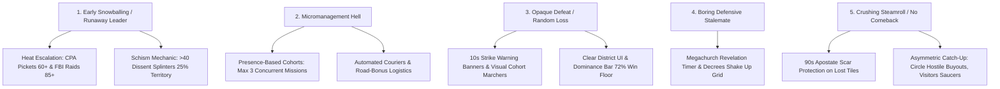

# FLOCK — Master Game Design Document

**Genre:** Browser-first competitive territory strategy (.io) × asymmetric cult-builder  
**Pitch:** *OpenFront meets Cult of the Lamb — the first competitive multiplayer cult-builder.*  
**Match Length:** 8–20 minutes | **Players:** 4–100 humans + AI (up to 300 entities)  
**Monetization:** Free-to-Play, strictly cosmetic and supporter passes. **Never pay-to-win.**

---

## 1. Vision, Satirical Tone & Core Pillars

### 1.1 The Fantasy & Satirical Tone
You play a charismatic mastermind founding a fringe movement in the satirical American town of **Mundane Falls, USA**. Your objective: out-maneuver, out-fund, and out-convert rival movements to become the last congregation standing.
* **Tone**: Cute-creepy satire of *mechanisms* (financial greed, psychological manipulation, devotion, bureaucracy) — never real-world faiths, figures, or real-world tragedies (§30 Tone Guardrail).

### 1.2 The Five Pillars
* **P1: Ten-Seconds-to-Play / Ten-Years-to-Master**: Minimal barrier to entry. Drag to pan, click or right-click to dispatch cohorts via the 3-sector Mission Wheel, instantly readable 8px map. High strategic ceiling in district matchups, heat management, and timing windows.
* **P2: Asymmetry is the Moat**: Four distinct archetypes playing fundamentally different games (Crusade aggro, Corporate finance, Wellness MLM, Alien saucer contactees).
* **P3: Betrayal is Content**: Alliances are fragile pacts (`ALLY`, `ACCEPT`). Attacking an ally triggers the `JUDAS` mechanic, slashing defense by 50% for 30s, creating dramatic match climaxes.
* **P4: The Money is the Joke**: Fictional in-game dollars fund absurd recruitment drives and bribes. Real money remains strictly cosmetic.
* **P5: Every Match Ends in a Story**: Shareable post-match recap cards generate headlines capturing match narratives ("The Circle Bought the Town Hall While Dawn Burned the Suburbs").

---

## 2. Anti-Bounce & Retention Strategy (Why Players Stay)

Competitive RTS and territory games frequently suffer from player bounce. FLOCK is architected to counter the top 5 bounce reasons:



1. **Anti-Snowballing**: Leading players generate more Heat from aggressive fronts. At Heat $\ge 60$, CPA pickets throttle conversion pressure by $-30\%$. At Heat $\ge 85$, FBI deprogramming raids scar believer tiles and spike dissent. Over-extended cults with $>40$ average dissent trigger a **Schism**, splitting 25% of their territory into an independent bot sect.
2. **Anti-Micromanagement**: Combat uses high-level cohort presence (Spread, Crusade, Tend). Couriers ferry tithe cash automatically between collection plates. No individual unit micromanagement.
3. **Transparent Telegraphing**: Major strikes show a 10s countdown banner. Marching cohorts visibly walk the street network.
4. **Stalemate Breaking**: Holding the Megachurch triggers a 90s countdown + 20s channel to force a decisive Revelation climax.
5. **Comeback Dynamics**: Converted tiles lost to strikes or raids generate **Apostate Scars** for 90s (immune to reconversion), acting as a buffer that stops runaway steamrolls.

---

## 3. The Four Asymmetric Factions

```mermaid
quadrantChart
    title Faction Strategy Spectrum
    x-axis Aggressive Expansion --> Economic / Strategic
    y-axis High Visibility (Heat) --> Low Visibility (Stealth)
    quadrant-1 Corporate Finance
    quadrant-2 Direct Holy War
    quadrant-3 Fringe Technology
    quadrant-4 Social Infiltration
    Dawn: [0.25, 0.75]
    Circle: [0.8, 0.85]
    Visitors: [0.2, 0.25]
    Radiant: [0.75, 0.3]
```

### 3.1 The Final Dawn (`dawn` — Orthodox Zealots)
* **Coefficients**: $R_0 = 1.05$, $\text{Retain} = 0.80$, $\text{Income} = 0.80$, $\text{Heat} = 1.40$, $\text{Growth} = 1.00$.
* **Passives**:
  * *Fear Feeds Us*: Conversion pressure $+2\%$ per deployed cohort in the match (capped at $+15\%$).
  * *Doomsday Bunker*: Losing a Church or Megachurch detonates all other held holy ground into neutral apostate scars.
* **Abilities**:
  * `street_prophet` ($12\text{k}, 45\text{s CD}$): Spawns a pylon emitting 40-follower conversion pressure for 30s at radius 2.
  * `stockpile_sermon` ($30\text{ Faith}, 90\text{s CD}$): $3\times$ conversion pressure in target district for 12s; leaves $+10$ dissent aftershock.
  * *Prophecy (Signature)*: Once per match at $\ge 1{,}500$ tiles. $+15$ Heat, 180s countdown. Success triggers Rapture (converts neutral/enemy tiles with $S \ge 65$ within 4 border steps, $+30$ Faith). Failure costs $-40$ Faith, $-15\%$ followers, $+20$ dissent.

### 3.2 The Radiant Path (`radiant` — Wellness MLM / Juice Cleanse)
* **Coefficients**: $R_0 = 1.00$, $\text{Retain} = 1.50$, $\text{Income} = 1.10$, $\text{Heat} = 0.70$, $\text{Growth} = 1.10$.
* **Passives**:
  * *Radiant Glow*: Continuously held believer tiles gain $+0.4\%/\text{s}$ retention defense (up to $+80\%$ at 200s).
  * *Organic Co-Op*: Supermarket civic control grants $+40\%$ retention defense ($\times 1.40$).
  * Exclusive Building: `supplement_lab`.
* **Abilities**:
  * `juice_cleanse` ($20\text{k}, 60\text{s CD}$): Instantly clears all dissent to 0 in target district.
  * `free_retreat_weekend` ($35\text{k}, 90\text{s CD}$): Radius-8 aura for 25s: $2.5\times$ conversion vs neutral, $1.5\times$ vs enemy, 0 Heat.

### 3.3 The Prosperity Circle (`circle` — Corporate Dark Ledger)
* **Coefficients**: $R_0 = 1.00$, $\text{Retain} = 0.90$, $\text{Income} = 1.30$, $\text{Heat} = 1.00$, $\text{Growth} = 0.90$.
* **Passives**:
  * *Downline*: Tiles flipped by ambient creep alone pay $2\times$ tithe forever.
  * *Franchise Megacenter*: Bank civic control triples courier cash payouts ($\times 3$).
  * *Scandal Vulnerability*: Loses $1.5\times$ normal followers from scandals (up to $52.5\%$).
* **Abilities**:
  * `seminar_blitz` ($60\text{k}, 75\text{s CD}$): Grants $+2{,}500$ followers instantly (clamped to cap).
  * `hostile_acquisition` ($300\text{k}, 240\text{s CD}$): Instantly buys and converts up to 120 contiguous neutral tiles in a district.
  * *Revelation Victory (The Ledger)*: Win match by accumulating $\$1.2\text{M}$ (S), $\$3\text{M}$ (M), or $\$6\text{M}$ (L).

### 3.4 The Visitors' Fellowship (`visitors` — Saucer Contactees)
* **Coefficients**: $R_0 = 1.00$, $\text{Retain} = 1.00$, $\text{Income} = 0.90$, $\text{Heat} = 1.10$, $\text{Growth} = 1.00$.
* **Passives**:
  * *Deep Space Transmitter*: Holding Radio Tower landmark eliminates the 10s strike warning banner for rivals.
* **Abilities**:
  * `crop_circle` ($15\text{k}, 60\text{s CD}$): Increases susceptibility $+30\,S$ for 60s across target district.
  * `radio_static` ($20\text{ Faith}, 90\text{s CD}$): Radius-8 burst causing $+30$ dissent on enemy believer tiles.
  * *Saucer Landing (Signature)* ($25\text{k}, 150\text{s CD}$): Instantly converts any neutral citizen tile across the map, places a Satellite building, and adds $+2{,}000$ Follower Cap.

---

## 4. Core Mathematical Engine

### 4.1 Follower Cap & Population Growth
* **Follower Cap**:
  $$\text{Cap} = 5{,}000 + (25{,}000 \times \text{compounds}) + (2{,}000 \times \text{satellites})$$
  * Commune upgrades (Stages 1–5): $\$15{,}000 \times 1.35^{\text{stage}-1}$ ($-12\%$ with Sawmill civic).
  * Crowding Penalty: If non-building tiles in property $< 3$, Cap is multiplied by $0.85$ ($-15\%$).
* **Passive Follower Growth**:
  $$\text{recruits/s} = \left(1.0 + \text{believers} \times 0.005\right) \times \left(0.8 + \frac{\text{Faith}}{250}\right) \times \text{stanceMod} \times \text{archGrowth} \times \text{civicGrowth}$$
  * Stance Modifiers: Tend = $1.10$; Spread = $1.00$; Crusade = $0.80$.
  * Civic Growth: High School = $\times 1.15$; Indoctrination Pipeline monopoly = $\times 1.20$.
* **Recruitment Drive (`BUY_RECRUITS`)**: Buys $200\text{‰}$ (20%) of current flock at $\$25/\text{recruit}$.

### 4.2 Economy & Tithe Formula
$$\text{tithe/s} = \$0.04 \times \text{followers} \times \text{incomeAvg} \times \left(1.0 - \frac{\text{avgDissent}}{200}\right) \times \text{archIncome} \times \text{doctrineTithe} \times \text{anchorMult}$$
* $\text{archIncome}$: Circle = $1.30$, Radiant = $1.10$, Visitors = $0.90$, Dawn = $0.80$.
* $\text{doctrineTithe}$: B1 Tithing Drill = $1.10$.
* $\text{anchorMult}$: Grain Elevator or Cannery = $1.10$.
* **Couriers**: Auto-spawn every 20s between pairs of $\ge 50\%$-staffed Collection Plates. Cargo: $\min(\text{pathLength} \times \$4,\, \$1{,}200)$ (tripled to $\$3{,}600$ for Circle with Bank). Speed: 1.5 tiles/s on grass, 3.0 tiles/s on roads. Intercepted by enemy Vans.

### 4.3 Combat & Conversion Mathematics
* **Attack Pressure**:
  $$\text{Pressure/s} = \frac{14.0 \times (R_0 \times \text{r0Mult}) \times \text{modeMult} \times \text{dc.conv} \times \text{targetMod} \times \left(0.85 + \frac{\text{Faith}}{333}\right) \times \text{buffs} \times \left(\frac{\text{effAttackers}}{60}\right)}{\text{Resistance}}$$
  * Doors Worked: $\max\left(1,\, \min\left(12,\, 1 + \lfloor\text{mass}/15\rfloor\right)\right)$. Effective attackers per door capped at 60.
  * `modeMult`: Spread = $1.0$; Crusade = $1.5$; Tend does not convert.
  * CPA Pickets: Inside radius 4 reduces pressure by $-30\%$ ($\times 0.70$).
  * Town Curfew Decree: Completely freezes rival conversion pressure in district.
* **Defense Resistance**:
  * Neutral: $1.0$ ($2.0$ Landmark; $3.5$ Key Civic Lot).
  * Enemy:
    $$\text{Res} = \left(1 + \frac{\text{defendersPerTile}}{40}\right) \times \text{dc.retain} \times \text{fortMult} \times \text{archRetain} \times \left(0.85 + \frac{\text{Faith}}{333}\right) \times \text{bonuses}$$
    * $\text{fortMult}$: Watchtower inside radius 6 gives $1 + 4 \times \text{staffingRatio}$ (up to $5\times$).
    * B2 Uniforms: $\times 1.15$; Supermarket: $\times 1.20$; Food Rationing Decree: $\times 1.35$.
    * Tend Stance: $\times 1.20$; Crusade Stance: $\times 0.75$.
    * Tend Cohort Presence: $\times \left(1 + \frac{\text{mass}}{200}\right)$.
* **Flipping & Attrition**:
  * Tile flips at progress $\ge 100$. Buildings on flipped tiles are destroyed.
  * Attacker Attrition: $0.6$ followers/s per worked tile.
  * Defender Attrition: $0.35$ followers/s per defended tile (halved to $0.175$ with B4).
  * Crusade Cohort Attrition: $0.2\%/\text{s}$ mass loss.

### 4.4 Stances
| Stance | Commit | Mult | Growth | Defense | Side Effects |
| :--- | :---: | :---: | :---: | :---: | :--- |
| **Tend** | 15% | $0.6\times$ | $+10\%$ | $+20\%$ | $2\times$ Dissent decay ($-0.30/\text{s}$). Cohorts boost defense by $\frac{\text{mass}}{200}$ and generate $+0.40$ Faith/s. |
| **Spread** | 40% | $1.0\times$ | $1.0\times$ | $1.0\times$ | Balanced posture. |
| **Crusade** | 75% | $1.5\times$ | $-20\%$ | $-25\%$ | $+0.04/\text{s}$ Heat; $+12$ Dissent per capture; cohorts suffer $0.2\%/\text{s}$ mass attrition. |

### 4.5 Heat, CPA Pickets & Law Enforcement
* **Base Decay**: $-0.08/\text{s}$ (Town Hall adds $-0.25/\text{s}$, Sheriff adds $-0.10/\text{s}$).
* **Heat $\ge 60$ (CPA Pickets)**: CPA deploys 2 picket lines (radius 4, 45s duration) on largest active cohort, suppressing conversion pressure by $-30\%$. (Raised to 75 with Town Hall, 85 with Town Machine monopoly).
* **Heat $\ge 85$ (FBI Deprogrammer Bus)**: Every 45s, a bus raids highest-dissent district, scarring believer tiles (radius 3) and adding $+15$ dissent.
* **Scandal Link**: Publishing a scandal costs the target $\text{clamp}(\text{Heat} \times 0.6,\, 5\%,\, 35\%)$ of followers ($1.5\times$ for Circle).

---

## 5. Buildings, Staffing & Infrastructure

All buildings require converted congregation living within `STAFF_RADIUS = 6`. Effectiveness = $\min(1, \text{nearby} / \text{staff})$.

| Building | Cost | Cost Growth | Build Time | Radius | Max | Staff | Effects |
| :--- | :---: | :---: | :---: | :---: | :---: | :---: | :--- |
| `compound` | $\$15\text{k}$ | $1.35\times$ | 20s (200t) | 8 | 1 (stg 5) | 40 | $+10\%$ defense radius 8. Supports 3 Vans. Upgrades stage 1–5. |
| `collection_plate`| $\$10\text{k}$ | $1.0\times$ | 15s (150t) | 0 | 6 | 25 | Paired plates spawn Couriers every 20s. |
| `watchtower` | $\$12\text{k}$ | $1.25\times$ | 18s (180t) | 6 | 10 | 20 | Fortification ($1 + 4 \times \text{staffing}$). Vision radius 10 kills agents in 3s. |
| `broadcast_tower` | $\$250\text{k}$| $1.0\times$ | 45s (450t) | 0 | 2 | 90 | Legacy propaganda anchor. |
| `supplement_lab` | $\$25\text{k}$ | $1.0\times$ | 20s (200t) | 5 | 4 | 30 | **Radiant exclusive**. Adjacent non-owned citizen tiles pay $\$0.004/\text{s}$. |
| `satellite` | $\$25\text{k}$ | $1.0\times$ | Instant | 0 | 99 | 0 | **Visitors exclusive**. Grants $+2{,}000$ Follower Cap. |

* **Property Parcels (`BUY_PROPERTY`)**: Cost $\$8{,}000 \times 1.5^{\text{parcels}}$. Claims $5\times 5$ parcel. Must link to holdings within 14 tiles.

---

## 6. B.I.T.E. Doctrine Tree

Purchased using **15 Faith** per node (`DOCTRINE_FAITH_COST = 15`). Tier 3 requires 2 picks in branch; Tier 4 requires 3 picks in branch.

| Node | Name | Branch | Cost | Status | Engine Effect |
| :---: | :--- | :--- | :---: | :---: | :--- |
| **B1** | Tithing Drill | Behavior | 15 Faith | Active | Tithe income $+10\%$ |
| **B2** | Uniforms | Behavior | 15 Faith | Active | Home-tile defense retention $+15\%$ |
| **B3** | Curfews | Behavior | 15 Faith | Active | Dissent gains from own actions $-40\%$ |
| **B4** | Total Devotion | Behavior | 15 Faith | Active | Defender attrition $-50\%$ |
| **I1** | The Truth (T1) | Information| 15 Faith | *Stub* | Roadmap feature |
| **I2** | The Truth (T2) | Information| 15 Faith | *Stub* | Roadmap feature |
| **I3** | Strong Signal | Information| 15 Faith | Active | Strike radius $+30\%$, cost $-20\%$ |
| **I4** | The Truth (T4) | Information| 15 Faith | *Stub* | Roadmap feature |
| **T1** | Better Pamphlets | Thought | 15 Faith | Active | Base conversion $R_0 +10\%$ |
| **T2** | Whisper Network | Thought | 15 Faith | Active | Ambient creep speed $+60\%$ |
| **T3** | Forgiveness | Thought | 15 Faith | Active | Apostate scars heal in half time (45s vs 90s) |
| **T4** | Irresistible Word | Thought | 15 Faith | Active | Attacks ignore 50% of district retain |
| **E1** | Welcome Basket | Emotion | 15 Faith | Active | Love-bomb abilities $-30\%$ cost |
| **E2** | Family Now | Emotion | 15 Faith | Active | Deprogramming raids $-50\%$ radius |
| **E3** | Clean Image | Emotion | 15 Faith | Active | Heat gains $-30\%$ |
| **E4** | Unshakeable | Emotion | 15 Faith | Active | Negates the first mass-apostasy event |

---

## 7. Civic Decrees & Municipal Monopolies

Control requires strict majority of believer tiles of that lot type.

### 7.1 The 7 Municipal Decrees
1. **Town Curfew** (`Sheriff`): $\$10\text{k}, +10\text{ Heat}, 90\text{s CD}, 15\text{s dur}$. Freezes rival conversion fronts in district.
2. **Pep Rally** (`HighSchool`): $\$12\text{k}, 100\text{s CD}, \text{Instant}$. Spawns $+1{,}200$ followers (overflow converts to $\$0.50$ cash).
3. **Parent-Teacher Night** (`School`): $\$6\text{k}, 60\text{s CD}, 30\text{s dur}$. Doubles ambient creep speed in district.
4. **Food Rationing** (`Supermarket`): $\$15\text{k}, 15\text{ Faith}, 120\text{s CD}, 25\text{s dur}$. $+35\%$ retention defense in district.
5. **Evangelical Revival** (`Church`): $20\text{ Faith}, 75\text{s CD}, \text{Instant}$. $+15$ Faith and $+20$ conversion pulse to adjacent neutral tiles.
6. **Municipal Injunction** (`TownHall`): $\$30\text{k}, +20\text{ Heat}, 150\text{s CD}, 20\text{s dur}$. Freezes enemy building construction in Town Hall & adjacent districts.
7. **Emergency Jam** (`RadioTower`): $\$40\text{k}, 120\text{s CD}, 15\text{s dur}$. Freezes rival strike charge timers and blocks enemy stance switches.

### 7.2 The 4 Municipal Monopolies
1. **Town Machine** (`TownHall` + `Sheriff`): CPA Harass threshold raised to Heat 85; auto-arrests stealth agents.
2. **Indoctrination Pipeline** (`HighSchool` + `School`): Follower growth $+20\%$; $+25$ bonus followers per neutral tile flip.
3. **Food & Fuel Cartel** (`Supermarket` + owned `GasStation`): Enemy building costs $+30\%$; friendly Vans move $+35\%$ faster.
4. **Sacred Canopy** (`Megachurch` + `Church`): Faith never drifts below 50; Sermon buff potency $\times 1.5$.

---

## 8. District Zoning & Coefficients

| District ID | District | `conv` | `retain` | `income` | Household Pop | Empty Yard % | Strategic Value |
| :---: | :--- | :---: | :---: | :---: | :---: | :---: | :--- |
| `0` | None | 1.0 | 1.0 | 1.0 | 0 | 100% | Wilderness, roads, property |
| `1` | Suburbs | 1.0 | 1.2 | 1.0 | 4–8 | 28% | Early expansion core; steady tithe |
| `2` | College | 1.6 | 0.6 | 0.7 | 5–10 | 16% | Fast conversion; fragile retention |
| `3` | Downtown | 0.9 | 1.0 | 1.5 | 7–13 | 8% | Dense population, high tithe, Town Hall |
| `4` | Old Town | 0.5 | 1.6 | 1.3 | 3–6 | 40% | Heavily fortified; stubborn to convert |
| `5` | Trailer | 1.3 | 0.9 | 0.6 | 2–5 | 50% | Cheap peripheral foothold |
| `6` | Commercial | 0.8 | 1.0 | 1.7 | 4–8 | 12% | Strip malls, diners, gas stations; high cash |
| `7` | Industrial | 1.1 | 0.8 | 1.1 | 3–6 | 35% | Rail sidings, warehouses, depots |
| `8` | ResHigh | 1.2 | 0.9 | 0.9 | 9–15 | 6% | Dense apartment core surrounding Downtown |

---

## 9. Victory Conditions

1. **Doctrinal Revelation**: Hold the Downtown **Megachurch** for 90 seconds, followed by a 20-second channel at Faith 100.
2. **Domination Threshold**: Secure $\ge 72\%$ (S/M maps) or $\ge 80\%$ (L maps) of all populated citizen tiles.
3. **Economic Victory (The Ledger)**: Prosperity Circle only: Bank $\$1{,}200{,}000$ (S), $\$3{,}000{,}000$ (M), or $\$6{,}000{,}000$ (L).
4. **Timer Expiry**: Highest Believer count, broken by Treasury cash, then Faith.
