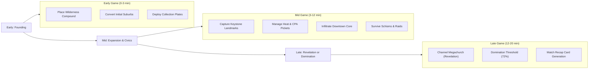

# FLOCK — Master Game Design Document

**Genre:** Browser-first competitive territory strategy (.io) × asymmetric cult-builder  
**Pitch:** *OpenFront meets Cult of the Lamb — the first competitive multiplayer cult-builder.*  
**Match Length:** 8–20 minutes | **Players:** 8–100 humans + AI (up to 300 entities)  
**Monetization:** Free-to-Play, strictly cosmetic and supporter passes. **Never pay-to-win.**

---

## 1. Vision & Core Pillars

### 1.1 The Fantasy & Satirical Tone
You play a charismatic mastermind founding a fringe movement in the satirical American town of **Mundane Falls, USA**. Your objective: out-maneuver, out-fund, and out-convert rival movements to become the last congregation standing.
* **Tone**: Cute-creepy satire of *mechanisms* (financial greed, psychological manipulation, devotion, bureaucracy) — never real faiths or real tragedies.

### 1.2 The Five Pillars
* **P1: Ten-Seconds-to-Play / Ten-Years-to-Master**: Minimal barrier to entry. Drag to expand territory, click to place collection plates, instantly readable 8px map. High strategic ceiling in district matchups, heat management, and timing windows.
* **P2: Asymmetry is the Moat**: Four distinct archetypes that play fundamentally different games (Crusade aggro, Corporate finance, Wellness MLM, Alien saucer tech).
* **P3: Betrayal is Content**: Alliances are fragile pacts. Attacking an ally triggers the `JUDAS` mechanic, but backstabbing at the critical Revelation window creates unforgettable match climaxes.
* **P4: The Money is the Joke**: Fictional in-game dollars fund absurd recruitment drives and bribes. Real money remains strictly cosmetic.
* **P5: Every Match Ends in a Story**: Shareable post-match recap cards generate headlines capturing the match narrative ("The Circle Bought the Town Hall While Dawn Burned the Suburbs").

---

## 2. The Four Asymmetric Factions

```mermaid
quadrantChart
    title Faction Strategy Spectrum
    x-axis Aggressive Expansion --> Economic / Strategic
    y-axis High Visibility (Heat) --> Low Visibility (Stealth)
    quadrant-1 Corporate Finance
    quadrant-2 Direct Holy War
    quadrant-3 Fringe Technology
    quadrant-4 Social Infiltration
    Dawn: [0.25, 0.75]
    Circle: [0.8, 0.85]
    Visitors: [0.2, 0.25]
    Radiant: [0.75, 0.3]
```

### 2.1 The Dawn (Orthodox Zealots)
* **Playstyle**: High-tempo religious warfare and aggressive front pressure.
* **Core Doctrine**: *Crusade Stance*. Converts neutral and enemy border tiles at $+40\%$ speed, but generates steady Heat.
* **Unique Assets**: Stone Cathedrals, Watchtowers (fortifies adjacent tiles against conversion), and Holy Relic Processions.

### 2.2 Radiant (Wellness MLM / Juice Cleanse)
* **Playstyle**: Low-heat social infiltration, high follower retention, and media manipulation.
* **Core Doctrine**: *Juice Cleanse & Seminar Blitz*. Zeroes district dissent instantly; recruits through grocery stores and health clubs.
* **Unique Assets**: Organic Juice Bars, Wellness Retreats, and Social Media Influencer Vans.

### 2.3 The Circle (Corporate Dark Ledger)
* **Playstyle**: Economic domination, hostile real estate buyouts, and institutional capture.
* **Core Doctrine**: *Hostile Takeover*. Can directly purchase neutral or lightly-defended property using money rather than faith conversion.
* **Unique Assets**: Consulting Suites, Offshore Wire Offices, and the *Revelation Financial Victory* (holding wealth cap).

### 2.4 The Visitors (Alien Saucer Contactees)
* **Playstyle**: Asymmetric guerrilla expansion, remote wilderness compounds, and tech anomalies.
* **Core Doctrine**: *Saucer Landing & Crop Circles*. Drops remote footholds in deep forests without territorial adjacency; crop circles rapidly accelerate surrounding conversion.
* **Unique Assets**: UFO Crash Sites, Monolith Arrays, and Sub-space Antennas.

---

## 3. Core Gameplay Loop



### 3.1 Early Game: The Founding
1. Players spawn at wilderness compounds equidistant from the town core.
2. Initial recruitment vans travel along roads to establish the first street-front believer clusters.
3. Collection plates are planted in high-population suburban blocks; couriers ferry cash back to headquarters.

### 3.2 Mid Game: Conflict & Escalation
1. **Keystone Landmark Contests**: Rival fronts collide over the Town Hall, Sheriff's Station, and High School.
2. **Heat & Law Enforcement**:
   * **Heat 0–59**: Normal municipal tolerance.
   * **Heat 60–84**: The CPA stages pickets, slowing cash collection and increasing follower dissent.
   * **Heat 85+**: Police and FBI deprogramming raids strike compounds, disabling buildings and creating temporary apostate scar tiles.
3. **Schism Mechanic**: If an oversized cult accumulates $>70\%$ dissent, it suffers a schism—splintering into an independent rogue faction controlled by bot AI.

### 3.3 Late Game: Victory Conditions
* **Doctrinal Revelation**: Capture and hold the Downtown **Megachurch** for 90 seconds, followed by a 20-second channel at Faith 100.
* **Domination**: Secure $\ge 72\%$ (or $\ge 80\%$ on L maps) of all populated citizen tiles.
* **Timer Expiry**: If match time runs out, winner is decided by:
  1. Highest Believer count
  2. Total funds earned
  3. Current Faith level

---

## 4. Civic Decrees & Town Governance

Holding the **Town Hall** allows the controlling player to enact municipal decrees every 120 seconds:
* **Curfew Order**: Restricts night movement on town roads, cutting enemy van speeds by $50\%$.
* **Zoning Variance**: Converts selected residential blocks into commercial parking aprons, boosting cash collection.
* **Police Funding Shift**: Directs the Sheriff's patrol away from your compound toward a rival's border.
* **Tax Audit**: Triggers an immediate CPA investigation against the richest competing player.
