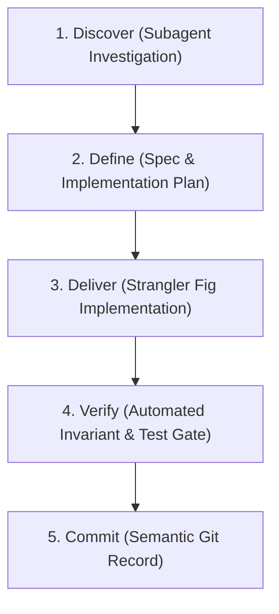

# FLOCK — Spec-Driven Development (SDD) & Modernization Roadmap

This document establishes the **Spec-Driven Development (SDD)** protocol and the prioritized feature roadmap for the **Claude Opus 5.5** modernization sweep.

---

## 1. The Spec-Driven Development (SDD) Protocol

To maximize reasoning capabilities and prevent context rot, all engineering passes executed by Opus 5.5 must adhere to the **Discover $\rightarrow$ Define $\rightarrow$ Deliver (D3)** cycle:

### 1.1 The REASONS Canvas Template
Before modifying any multi-file subsystem, author an implementation plan using the REASONS framework:

| Dimension | Definition | Checklist |
|---|---|---|
| **R** — Requirements | Business intent and acceptance criteria | What does success look like? What is explicitly out of scope? |
| **E** — Entities | Data schemas, state flags, and typed arrays | Are all types defined in `types.ts`? Are arrays flat and garbage-free? |
| **A** — Approach | Architectural pattern and blast radius | Using Strangler Fig facade? Adapter pattern? |
| **S** — Structure | Exact files to modify, create, or delete | Are file changes surgical (<300 lines)? |
| **O** — Operations | State transitions, turn loops, and network packets | Is simulation logic executed inside the 100ms lockstep tick? |
| **N** — Norms | Code style, positive constraints, determinism rules | Zero `Math.random()`, zero floating-point divergence, pure functions. |
| **S** — Safeguards | Test suites, invariant assertions, and rollback plan | Does `npm test` pass? Are replay state hashes invariant? |

---

## 2. High-Impact Modernization Backlog

### Track 1: Goal-Oriented Action Planning (GOAP) Bot AI ($60–$70 token budget)
* **Problem**: Current bot brains in `@flock/sim/src/bot.ts` rely on heuristic rules that struggle to orchestrate multi-turn strategies.
* **Target Architecture**:
  * Implement Utility AI / GOAP evaluating candidates:
    * *Front Expansion Utility*: evaluated against tile susceptibility and owner strength.
    * *Civic Capture Utility*: prioritizing Town Hall and Megachurch based on match timer.
    * *Heat Management Utility*: holding back crusades when Heat approaches 80 to prevent police raids.
  * Unique Faction Personas:
    * **Dawn Bot**: Prioritizes crusade fronts, cathedral fortresses, and zealot rallies.
    * **Circle Bot**: Hoards capital to execute rapid hostile property purchases and bribe decrees.
    * **Radiant Bot**: Maintains zero dissent, runs juice cleanses, and infiltrates high-pop suburbs.
    * **Visitors Bot**: Deploys deep wilderness saucer footholds and surrounds downtown with crop circles.

### Track 2: UI/UX Overhaul & Commercial Polish ($40–$50 token budget)
* **Radial Decree Wheel**: An intuitive circular overlay appearing when clicking an owned Town Hall, allowing one-click execution of municipal decrees.
* **Interactive Tile Inspector**: Floating contextual card displaying:
  * Population count, district affiliation, and susceptibility score.
  * Current conversion progress, active attacker fronts, and dissent status.
  * Property owner and building tier.
* **Minimap Enhancements**:
  * Real-time fog-of-war visualization.
  * Threat alert pings when enemy recruitment vans enter sovereign territory.
  * Landmark status badges (Megachurch channel timer progress bar).
* **Spectator Theater & Replay Playback**:
  * Smooth camera tracking following conversion fronts.
  * Turn timeline slider with play/pause and fast-forward ($1\times, 2\times, 4\times$).

### Track 3: Procedural Audio & Atmospheric Synthesizer ($25–$30 token budget)
* **Dynamic Synthesizer Expansion** (`packages/client/src/audio/`):
  * *Ambient Soundscape*: Subtle procedural wind, night crickets, and dawn birdsong modulated by season and time of day.
  * *Civic Atmosphere*: Church bells ringing when Faith is earned; steam train whistles echoing when trains visit the Depot.
  * *Combat Tension*: Ascending procedural minor chords when enemy fronts cross into domestic territory.
  * *Victory Fanfare*: Harmonic multi-oscillator chord sequences for match conclusion.

### Track 4: Automated Perceptual Visual Regression Suite ($30–$35 token budget)
* **Headless Visual CI** (`tools/visual_audit.mjs`):
  * Renders golden benchmark seeds (11, 21, 42, 77, 99) across all seasons and times of day.
  * Performs automated image diffing via `pixelmatch` / SSIM against golden raster references.
  * Enforces visual drift $<0.2\%$, preventing asset glitches, color bleeds, or building clipping before any commit.
