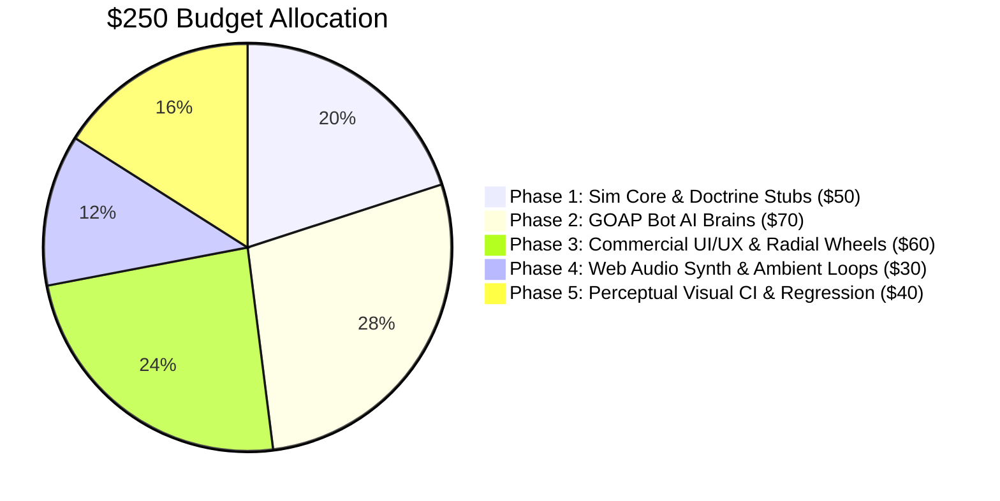
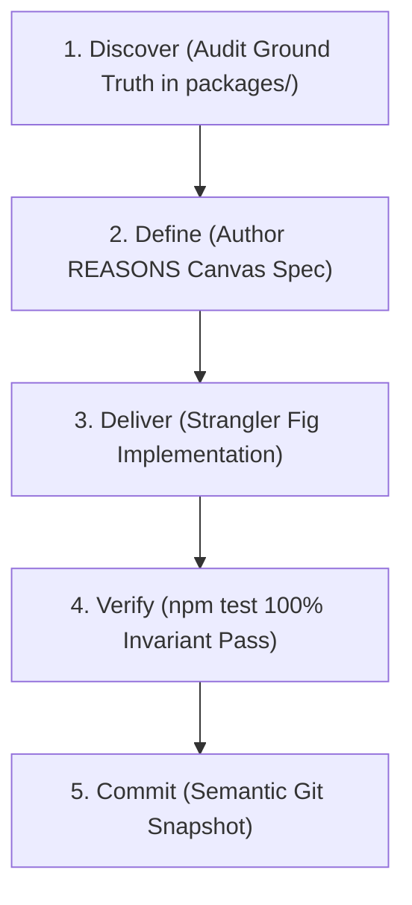

# FLOCK — Spec-Driven Development (SDD) & Claude Opus 5.5 Modernization Roadmap

This document outlines the **Spec-Driven Development (SDD)** protocol, strategic token budget allocation for the **Claude Opus 5.5** sandbox sweep ($250 credit), and high-impact engineering roadmaps.

---

## 1. Claude Opus 5.5 Execution Profile & Parameter Tuning

Claude Opus 5.5 is Anthropic's frontier coding model (released September 2026). It excels at deep cross-file reasoning, refactoring complex monolithic modules, and maintaining architectural coherence without hallucinations.

### 1.1 Model Technical Profile
* **Context Window**: 1,000,000 tokens (1M).
* **Max Output Generation**: 128,000 tokens (128k).
* **Pricing**: $\$4.00$ / M input, $\$20.00$ / M output, $\$0.20$ / M prompt cache reads ($90\%$ savings).
* **Always-On Adaptive Thinking**: Regulated via the `output_config.effort` parameter:
  * `effort: "high"`: Core simulation refactoring, lockstep synchronization, fixed-point math, and Glicko-2 ratings.
  * `effort: "medium"`: UI/UX layout, HUD components, audio synthesizers, and test suites.
  * `effort: "low"`: Documentation updates, asset catalog additions, and config tuning.

### 1.2 Prompt Tagging & Structure
Opus 5.5 demonstrates peak performance when instructions, context, constraints, and tasks are wrapped in explicit semantic XML tags (`<system_spec>`, `<invariants>`, `<code_context>`, `<task>`).

---

## 2. $250 Sandbox Credit Allocation Plan

With $\$250$ in Claude Code credits, token consumption translates to approximately **12.5M output tokens** or **60M cached input tokens**. To prevent context rot and exhaustion, development is structured into 5 prioritized phases:



### Budget Breakdown
| Phase | Focus Area | Token Budget | Primary Target Files | Key Deliverable |
| :---: | :--- | :---: | :--- | :--- |
| **1** | Sim Core & Stubs | $\$50$ (~2.5M out) | `doctrine.ts`, `conversion.ts`, `balance.json` | Implement missing BITE stubs (I1, I2, I4); tune doctrine costs & pacing. |
| **2** | GOAP Bot AI | $\$70$ (~3.5M out) | `bots.ts`, `sim.ts`, `cohorts.ts` | Utility-based Goal-Oriented Action Planning for all 4 archetypes. |
| **3** | UI/UX & Polish | $\$60$ (~3.0M out) | `hud.ts`, `wheel.ts`, `render.ts` | Town Hall Decree Wheel, Tile Inspector card, minimap POI alerts. |
| **4** | Audio & Atmosphere | $\$30$ (~1.5M out) | `audio.ts` | Procedural ambient loops (wind, crickets), combat tension chords, bells. |
| **5** | Visual CI & Regression | $\$40$ (~2.0M out) | `tools/visual_audit.mjs`, `townRender.ts` | Automated pixel diffing against curated golden images (`docs/assets/curated/`). |

---

## 3. The Spec-Driven Development (SDD) Protocol

To maximize reasoning efficiency and eliminate regression loops, every task must follow the **D3 Protocol (Discover $\rightarrow$ Define $\rightarrow$ Deliver)**:



### 3.1 The REASONS Canvas Template
Before editing multi-file subsystems, author an implementation plan using the REASONS structure:

| Dimension | Definition | Checklist |
|---|---|---|
| **R** — Requirements | User intent and gameplay acceptance criteria | What does success look like? What is explicitly out of scope? |
| **E** — Entities | Data schemas, state flags, and typed arrays | Are types added to `types.ts`? Are arrays flat and garbage-free? |
| **A** — Approach | Architectural pattern and blast radius | Using Strangler Fig facade? Adapter pattern? |
| **S** — Structure | Exact files to modify, create, or delete | Are file diffs surgical (<300 lines)? |
| **O** — Operations | State transitions, turn loops, and network packets | Is simulation logic executed inside the 100ms lockstep tick? |
| **N** — Norms | Code style, determinism rules, positive constraints | Zero `Math.random()`, zero floating-point divergence, pure functions. |
| **S** — Safeguards | Test suites, invariant assertions, rollback plan | Does `npm test` pass? Are replay state hashes invariant? |

---

## 4. Prioritized Feature Backlogs

### Track 1: Goal-Oriented Action Planning (GOAP) Bot AI ($70 Budget)
* **Problem**: Current bots in `bots.ts` use simple random timers and heuristic checks.
* **Target Architecture**:
  * Utility AI evaluating action candidates every cadence cycle:
    * *Front Expansion Utility*: evaluated against tile susceptibility $S$, distance, and defender strength.
    * *Civic Capture Utility*: prioritizing Town Hall, High School, and Megachurch based on match timer.
    * *Heat Management Utility*: switching to Tend stance when Heat approaches 60/85 to avoid CPA raids.
    * *Doctrine Purchase Utility*: evaluating optimal B.I.T.E. progression per archetype.
  * Unique Faction AI Personalities:
    * **Dawn Bot**: High-aggression crusader; rushes Watchtowers and Holy Relic Processions; targets rival churches.
    * **Circle Bot**: Hoards capital to execute hostile property purchases; secures Banks and Town Hall; plays for The Ledger.
    * **Radiant Bot**: Maintains zero dissent with Juice Cleanses; captures Supermarkets for Organic Co-op; infiltrates high-pop suburbs.
    * **Visitors Bot**: Deploys deep wilderness Saucer footholds; surrounds Downtown with Crop Circles; disrupts enemies with Radio Static.

### Track 2: UI/UX Commercial Polish & Radial Decree Wheel ($60 Budget)
* **Radial Civic Decree Wheel**: An intuitive circular SVG overlay appearing when clicking an owned Town Hall or civic POI, allowing one-click execution of the 7 municipal decrees.
* **Contextual Tile Inspector**: Floating card displaying:
  * Population, district affiliation, income, and susceptibility score $S$.
  * Active attacker cohorts, conversion progress bar, and dissent status.
  * Property ownership, building tier, and staffing ratio.
* **Minimap POI & Alert Enhancements**:
  * Real-time fog-of-war visualization.
  * Flashing crimson alerts when enemy Recruitment Vans or Agents enter sovereign territory.
  * Megachurch channel progress ring.

### Track 3: B.I.T.E. Information Doctrine Implementation ($50 Budget)
* **Problem**: In `doctrine.ts`, nodes `I1`, `I2`, and `I4` are unbuilt stubs.
* **Implementation Plan**:
  * **I1 (Broadcast Media)**: Radio Tower broadcasts increase neutral susceptibility by $+15\,S$ across the town.
  * **I2 (Disinformation Campaign)**: Reduces evidence accumulation rate from rival Agents by $50\%$.
  * **I4 (Total Narrative Control)**: When holding Town Hall, nullifies rival Propaganda Strikes and decreases civic decree costs by $25\%$.

### Track 4: Procedural Audio Synthesizer Expansion ($30 Budget)
* **Ambient Soundscape**: Subtle procedural wind noise modulated by season; night crickets and dawn birdsong generated via bandpass white noise.
* **Dynamic Tension Chords**: Ascending procedural minor chord sequences when enemy cohorts cross into domestic territory.
* **Civic Feedback**: Procedural church bells ringing when Faith is earned; train whistle echoes when Couriers arrive at the Depot.

---

## 5. Claude Opus 5.5 Prompt Templates for Claude Code

When launching Claude Code sessions in your sandbox, copy and paste these XML-structured prompts directly:

### Prompt 1: Bot AI GOAP Upgrade
```xml
<task>Implement Utility / GOAP Action Planning for FLOCK Bot AI</task>
<system_spec>
You are an expert game AI engineer modernizing the bot brains in @flock/sim/src/bots.ts.
FLOCK is a 10 Hz deterministic lockstep multiplayer strategy game. All bot actions MUST strictly emit standard Intent objects. Bots have ZERO fog exemptions and ZERO stat cheats.
</system_spec>
<requirements>
1. Review docs/GAME_DESIGN.md and packages/sim/src/bots.ts.
2. Refactor bot evaluation into a Utility AI evaluating candidate actions:
   - Expand Front (Spread vs Crusade based on Heat)
   - Capture Keystone Civic (targeting Sheriff, High School, Supermarket, Church, Town Hall)
   - Manage Heat (switch to Tend if Heat >= 60 to prevent CPA pickets)
   - Purchase Doctrines (evaluating B1-B4, T1-T4, E1-E4 based on archetype)
   - Enact Civic Decrees when holding institutions
3. Implement distinct tactical personalities for Dawn, Radiant, Circle, and Visitors.
4. Verify with: npm test
</requirements>
```

### Prompt 2: Town Hall Civic Decree Radial Wheel
```xml
<task>Implement Radial Civic Decree Wheel in @flock/client</task>
<system_spec>
You are a senior UI/UX engineer building interactive client controls in packages/client/src/.
The game uses a 1970s satirical cult aesthetic (Press Start 2P, VT323, Pixelify Sans, gold/crimson palettes).
</system_spec>
<requirements>
1. Review docs/GAME_DESIGN.md §7 (the 7 municipal active decrees) and packages/client/src/wheel.ts.
2. Implement a radial DecreeWheel component appearing when the player clicks an owned Town Hall or civic landmark.
3. Display available decrees with cost in USD/Faith, cooldown sweep indicators, and tooltips.
4. Discard clicks if the mouse dragged > 6px (respecting main.ts Manhattan deadzone calibration).
5. Verify with: npm test
</requirements>
```
