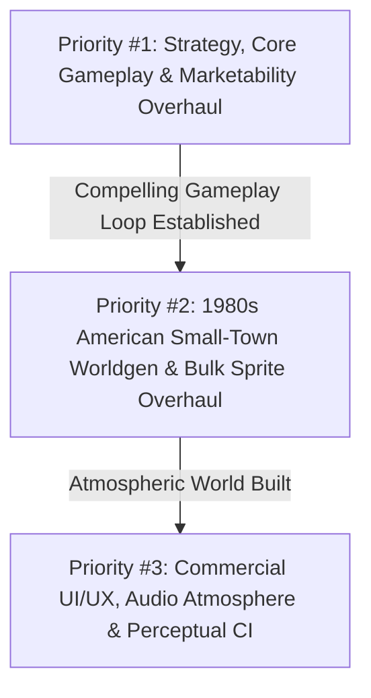
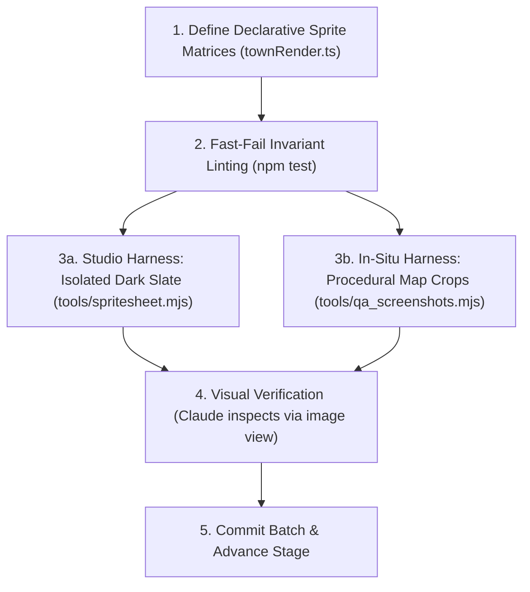

# FLOCK — Spec-Driven Development (SDD), 1980s Worldgen & Modernization Roadmap

This document outlines the **Spec-Driven Development (SDD)** protocol, token-efficient bulk sprite design pipeline, 1980s American small-town aesthetic ("Stranger Things" era), and budget checkpoint controls for the **Claude Opus 5.5** sandbox modernization sweep ($250 credit).

---

## 1. Creative Freedom & Autonomous Architectural Authority

Claude Opus 5.5 acts as the Lead Systems Architect and Game Director.
* **Broad Redesign & Refactoring Legroom**: The user has explicitly granted you extensive creative freedom. Treat the existing planning documents as an informed launchpad and baseline, acknowledging that you possess superior frontier reasoning capabilities and have full authority to make bold systemic judgments.
* **Reasoning Over Rigid Rails**: If your analysis reveals a cleaner architectural pattern, a more engaging strategy mechanic, a superior procedural generation heuristic, or a more token-efficient refactoring path, **you have full license to alter, re-order, replace, or rewrite these proposals**.
* **Guiding Anchors**:
  1. Faithfully capture the **1980s American Small-Town Aesthetic** (*Stranger Things* / Hawkins, Indiana era).
  2. Implement **Best Game Design Principles** (deep strategy, anti-snowballing, transparent telegraphing, high player retention).
  3. Maintain **Token-Efficient Execution** (programmatic bulk sprites, dual-QA studio/map verification, and stage checkpoints).
  4. Preserve **100% Lockstep Determinism** (`npm test` passes with zero violations).

---

## 2. Strategic Priority Hierarchy



1. **Priority #1: Strategy, Core Gameplay & Marketability Overhaul**
   - Deepen asymmetric faction mechanics (Dawn, Radiant, Circle, Visitors).
   - Refine anti-bounce mechanisms (Heat escalation, Schisms, Apostate Scars, Comeback tools).
   - Ensure the 100ms lockstep tick, presence cohorts, and victory conditions are tightly tuned and fiercely competitive.
2. **Priority #2: 1980s American Small-Town Worldgen & Bulk Sprite Overhaul ("Stranger Things" Era)**
   - Transform procedural town generation from basic geometric rectangles into an authentic, instantly recognizable 1980s Midwestern/American small town (the Hawkins, Indiana aesthetic, ~1983–1986).
   - Bulk design recognizable buildings, 1980s vehicles, realistic waterways, and dynamic seasonal foliage using the Dual-QA pipeline.
3. **Priority #3: Commercial UI/UX Polish, Web Audio Synth & CI Gates**
   - Radial Civic Decree Wheel for Town Hall, Contextual Tile Inspector, dynamic synthesizer ambient loops, and automated image regression testing.

---

## 3. The 1980s American Small-Town Aesthetic ("Stranger Things" Era)

The environmental art and procedural morphology must capture the nostalgic, slightly eerie charm of 1980s Americana:

### 3.1 Architectural Taxonomy & Urban Morphology
* **Downtown Courthouse / Town Hall Square**:
  - Neoclassical red-brick Town Hall with stone pediment, columned portico, bell cupola, and central municipal flagpole on manicured grass lawn.
  - Attached Main Street commercial blocks with wood/fabric awnings, retro neon/plastic signage, overhanging cornice trims, and 1px vertical party-wall seams.
* **1980s Commercial Strip**:
  - Classic diner with chrome trims and neon roof lettering.
  - Gas station with boxy rectangular pump islands, red/blue corporate striping, and corner service bays.
  - Video arcade / movie theater with illuminated marquee.
  - Radio station with red warning beacon atop a steel lattice transmitter tower.
* **1980s High School Campus**:
  - Low-slung 1970s/80s red-brick building with horizontal ribbon windows, exterior gymnasium annex, running track, football bleachers, and a dedicated yellow school bus parking apron.
* **Residential Suburbs**:
  - Wood-clapboard and vinyl-sided ranch houses and split-levels with front porches, pitched shingle roofs, detached garages, driveways with parked 1980s cars, backyard chain-link/picket fences, garden sheds, and circular above-ground pools.
* **Industrial Rail Lobe & Outskirts**:
  - Railroad depot with platform timbers, freight luggage carts, and brick quoin corners.
  - Tall concrete grain elevator with cylindrical silos and bucket elevators.
  - Corrugated steel lumber mill and gravel yard.
  - Municipal water tower on steel trestle legs with faded high school graduation year graffiti.

### 3.2 The 1980s Vehicle Fleet
Replace generic vehicles with recognizable 1980s silhouettes rendered at 8px:
* **Wood-Paneled Station Wagon** (Ford Country Squire style): Long body, rear overhang, brown wood-grain side paneling.
* **Boxy Sedans** (Chevy Caprice / Ford LTD): Rectangular chrome grille, distinct trunk and hood notches, amber indicator lights.
* **Square-Body Pickup / Chevy Blazer**: Elevated ground clearance, wide cab, optional two-tone paint.
* **Police Cruiser**: White/black doors, rooftop bubble/gumball flashing emergency lights.
* **Delivery & Recruitment Vans**: Boxy 1980s Dodge Ram Van / Chevy G20 with custom cult side stripes.
* **Yellow School Bus**: Extended yellow body with black rub rails and flashing stop sign arm.
* **BMX Bicycles**: Micro 2-pixel kids on bikes traversing residential sidewalks.

### 3.3 Natural Hydrology & Seasonal Foliage
* **Meandering River**: Sinusoidal curves with damp sand/gravel shoals, stone rapids, weeping willow fringes along banks, and timber/stone trestle railroad bridges.
* **Coastal Ocean**: Foam-crested breakers, driftwood, sandy dunes with sea oats, coastal docks, and striped brick lighthouse.
* **Rich Seasonal Foliage**:
  - *Spring*: Vibrant emerald lawns, flowering pink dogwoods/magnolias, and tilled farmland with bright green sprouts.
  - *Summer*: Deep lush green canopies with sharp cast shadows, full corn rows, and ripe wheat fields.
  - *Fall*: Blazing scarlet, burnt orange, and golden maple canopies, fallen leaf clusters along curbs, and golden hay bales.
  - *Winter*: Snow accumulation on north-facing roofs, bare branch silhouettes, frozen ice sheets, and snowbanks along plowed roads.

---

## 4. Token-Efficient Bulk Sprite Design & Dual-QA Strategy

Designing dozens of 8px pixel art sprites through an LLM can burn through an entire token budget if done via trial-and-error conversational dumps or blind coding. FLOCK implements a **declarative generation + headless dual-QA pipeline**:



### 4.1 Declarative Sprite Authoring (No Conversational Coordinate Spam)
* **The Failure Mode**: Asking an LLM to "draw a sprite" by printing hundreds of coordinates or ASCII character dumps into conversational context wastes tens of thousands of tokens and causes severe context rot.
* **The Solution**: Sprites are authored directly in code (`townRender.ts` and `palette.ts`) using **declarative compact character matrices** and procedural primitives:
  ```ts
  // Compact, token-efficient, and easily modifiable:
  const STATION_WAGON_80S = {
    w: 8, h: 4,
    palette: { '.': 0, 'c': C.carBody, 'w': C.woodTrim, 'g': C.glass, 'k': C.tire, 't': C.taillight, 'h': C.headlight },
    rows: [
      ".cccc...",
      "cgggggh.",
      "cwwwwk..",
      "tk.k....",
    ]
  };
  ```
  This requires $<30$ lines of code per vehicle or building family, reuses palette constants, and is completely deterministic.

### 4.2 The Dual-Harness Visual QA Protocol
1. **Harness A: Studio View (Blank Studio Slate Isolation)**:
   - Tool: `node tools/spritesheet.mjs` or `node tools/generate_catalog_inspection.mjs`.
   - Stamped on an isolated neutral dark slate (`#181512`) at $8\times$ zoom with 1px grid guides.
   - **What to Verify**:
     - *Silhouette Readability*: Can you immediately identify a wood-paneled station wagon vs. a Chevy Blazer vs. a boxy Caprice sedan at 8px?
     - *Color Contrast & Palettes*: Does the chrome bumper pop? Is the wood-grain trim distinct from the metal body?
     - *1px Panel Seams*: Do modular wall blocks and roof tiles render clean division seams without blurring into mush?
2. **Harness B: In-Situ View (Real Procedural Map Context)**:
   - Tool: `node tools/generate_curated_suite.mjs` (rendering seeds 11, 42, 77 across the 4 seasons and times of day).
   - Crops 5 high-resolution focal areas:
     1. *Downtown Courthouse Square & Main Street* (storefront awnings, curb cuts, sidewalks).
     2. *1980s High School Campus* (yellow bus parking, football bleachers, ribbon windows).
     3. *Suburban Cul-de-Sacs* (front porches, driveways, garden sheds, chain-link fences).
     4. *Industrial Rail Siding* (grain elevator silos, freight depot platform timbers).
     5. *Natural Waterways & Woods* (river gravel shoals, willow fringes, timber trestle bridges).
   - **What to Verify**: Buildings sit naturally on road frontage, parking lot curb cuts align with street lanes, and seasonal foliage blends seamlessly into surrounding terrain.

### 4.3 Fast-Fail Automated Linting
Before rendering PNGs, `npm test` enforces physical invariants:
* All palette colors are valid RGB integers in `palette.ts`.
* All sprite dimensions are within expected tile footprints ($8\times 8$, $16\times 8$, $16\times 16$, etc.).
* Zero non-exempt buildings on water; 6-tile industrial buffer respected.
* This catches boundary and typing errors instantly in $<2$ seconds without burning image generation or viewing tokens.

### 4.4 The 5 Logical Asset Batches
To maintain laser focus and controlled token pacing, asset creation is executed in 5 discrete batches:
* **Batch 1: The 1980s Vehicle Fleet** (Wood-paneled station wagons, boxy sedans, Blazers, bubble-light police cruisers, Dodge Ram vans, yellow school buses, BMX bikes).
* **Batch 2: Downtown & Main Street Commercial** (Courthouse Town Hall, fabric-awning storefronts, chrome diners, boxy gas stations, neon cinema/arcade).
* **Batch 3: Residential Suburbs & School Campus** (Clapboard ranch/split-level houses, red-brick high school with ribbon windows and bleachers, elementary playground).
* **Batch 4: Industrial Rail Lobe & Working Countryside** (Concrete grain elevator, timber depot station, saw mill, water tower with graffiti, red gambrel barns, tractor dirt tracks).
* **Batch 5: Natural Hydrology & Seasonal Foliage** (Meandering river sandbars, timber trestle bridges, ocean surf breakers, 4-season tree canopies with fallen leaves and snow accumulation).

---

## 5. Cost Self-Awareness & Stage Checkpoint Protocol

Claude Opus 5.5 has no intrinsic real-time odometer for sandbox billing. To guarantee the **$250 credit pool** is spent deliberately across the entire roadmap, Claude must enforce **mandatory stage pause checkpoints**:

### 5.1 $250 Budget Allocation Matrix
| Stage | Milestone | Budget | Target Deliverable |
| :---: | :--- | :---: | :--- |
| **Stage 1** | Strategy & Balance Overhaul | $\$45$ | Doctrine stubs (I1, I2, I4), anti-bounce tuning, comeback abilities |
| **Stage 2** | 1980s Town Morphology & Worldgen | $\$65$ | Downtown square, 1980s commercial strip, high school campus, shoaled rivers |
| **Stage 3** | Bulk Sprite Overhaul & 80s Vehicle Fleet | $\$55$ | 80s cars, station wagons, vans, police cruisers, houses, trees via Dual-QA |
| **Stage 4** | GOAP Bot AI with Faction Personalities | $\$50$ | Utility-based AI evaluating expansion, civics, heat, and faction themes |
| **Stage 5** | Commercial UI/UX & Web Audio Polish | $\$35$ | Radial Decree Wheel, contextual inspector, procedural ambient soundscapes |

### 5.2 Mandatory Stage Checkpoint Output
At the conclusion of each stage, Claude **must stop calling tools** and present this card:

```markdown
============================================================
--- MILESTONE CHECKPOINT [Stage N Complete] ---
============================================================
1. Milestone Accomplished: [Concise list of implemented features]
2. Automated Invariant Gate: npm test passed (135/135 tests, 75/75 worlds, 0 violations)
3. Visual Artifacts Generated: [Paths to studio spritesheet / map crops]
4. Estimated Stage Token Spend: ~$XX (Remaining estimated credit: ~$YY)
5. Proposed Next Stage: [Stage N+1 Title and core scope]
------------------------------------------------------------
> Awaiting user feedback. Please share your current Claude Code credit balance and reply 'PROCEED' or specify any plan adjustments.
============================================================
```

---

## 6. Ready-to-Paste Claude Code Prompt Templates

### Prompt 1: Priority 1 Strategy & Game Balance Overhaul
```xml
<task>Execute Priority 1: Strategy, Core Gameplay & Marketability Overhaul</task>
<system_spec>
You are Lead Systems Architect for FLOCK. You have full architectural autonomy to refine or rewrite mechanics.
Review docs/GAME_DESIGN.md and packages/sim/src/.
</system_spec>
<requirements>
1. Implement the unbuilt B.I.T.E. Information doctrine nodes (I1, I2, I4) in doctrine.ts with impactful strategic effects.
2. Refine anti-bounce and catch-up mechanics (Heat scaling, Schism thresholds, and Apostate Scars) to eliminate runaway snowballing and boring stalemates.
3. Sharpen the asymmetric win conditions and faction identities (Dawn crusade pressure, Circle financial takeovers, Radiant retention defense, Visitors saucer drops).
4. Run npm test to verify all 135 tests pass cleanly.
5. Present the Stage 1 Checkpoint Card with token estimate and pause for user input.
</requirements>
```

### Prompt 2: Priority 2 1980s Small-Town Worldgen & Bulk Sprite Overhaul
```xml
<task>Execute Priority 2: 1980s American Small-Town Worldgen & Bulk Sprite Overhaul</task>
<system_spec>
You are Lead Systems Architect and Art Director for FLOCK.
Transform the procedural town into an authentic 1980s American small town (Hawkins, Indiana / Stranger Things aesthetic).
Review docs/WORLDGEN.md, packages/sim/src/mapgen.ts, and packages/sim/src/townRender.ts.
</system_spec>
<requirements>
1. Upgrade procedural urban morphology: Downtown courthouse square, Main St awnings/signage, 1980s red-brick high school with sports fields, wood-clapboard residential suburbs with porches and sheds, and industrial rail siding.
2. Bulk design the 1980s vehicle fleet: wood-paneled station wagons, boxy sedans, Chevy Blazers, bubble-light police cruisers, school buses, and BMX bikes.
3. Enhance hydrology and foliage: meandering river with sand/gravel shoals, coastal ocean surf, and rich 4-season foliage.
4. Execute Dual-QA: generate studio spritesheet via tools/spritesheet.mjs and in-situ map crops via tools/generate_catalog_inspection.mjs.
5. Run npm test to verify 100% invariants pass.
6. Present the Stage 2 Checkpoint Card with token estimate and pause for user input.
</requirements>
```
