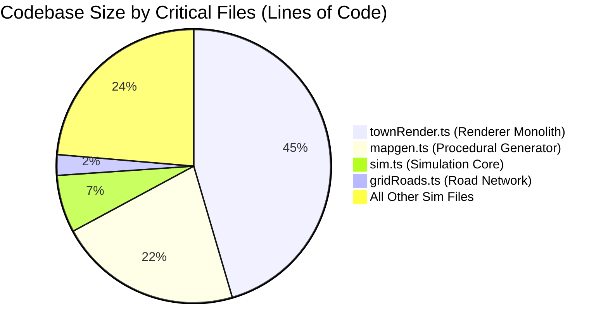
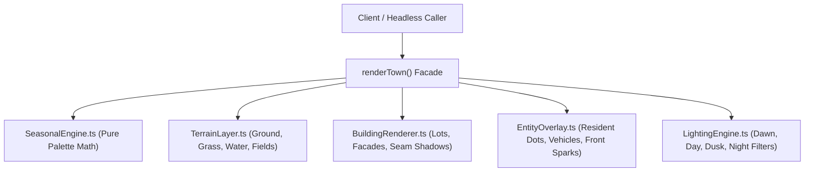
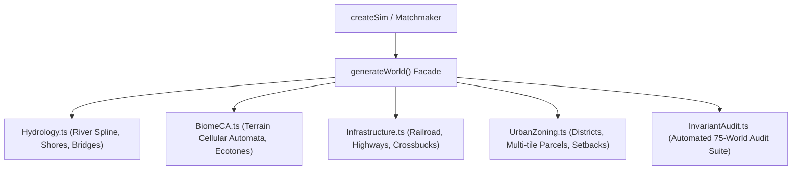

# FLOCK — Technical Debt Inventory & Refactoring Blueprints

This document catalogs the accumulated technical debt in the **FLOCK** codebase and provides structural refactoring blueprints using the **Strangler Fig pattern** for the **Claude Opus 5.5** modernization pass.

---

## 1. Monolithic Hotspots & Complexity Analysis

### Hotspot 1: `packages/sim/src/townRender.ts` (~5,960 lines)
* **Symptoms**:
  * Massive single file handling 8×8 sprite definitions, building switches, vehicle movement, resident dot pathing, seasonal color shifts, and diurnal lighting filters.
  * Mutable global configuration object `C` mutated synchronously during `renderTown`.
  * Cognitive Complexity exceeds 120 in central drawing dispatchers.
* **Risks**: High risk of unintended visual regressions when editing individual lot or seasonal routines.

### Hotspot 2: `packages/sim/src/mapgen.ts` (~2,840 lines)
* **Symptoms**:
  * Couples cellular automata terrain generation, river spline mathematics, orthogonal road growth, district zoning, and multi-tile parcel placement.
  * Invariant assertions and audit routines are embedded directly inside generation logic.
* **Risks**: Modifying lot spacing heuristics risks violating connectivity or road frontage invariants across seed variations.

---

## 2. Strangler Fig Modernization Blueprints

To refactor these monolithic files without risking Second System Syndrome or breaking multiplayer lockstep determinism, Opus 5.5 must employ the **Strangler Fig pattern**:

### Blueprint A: Decomposing `townRender.ts`

#### Step-by-Step Modernization Strategy:
1. **Create Proxy Facade**: Keep `renderTown(sim: SimState, opts: RenderOpts)` as the exported API contract.
2. **Extract `SeasonalEngine.ts`**:
   * Move mutable `C` into an immutable, pure function: `getSeasonalPalette(season: Season): PaletteColors`.
   * Eliminate global state mutation; pass palette down through render options.
3. **Extract `BuildingRenderer.ts`**:
   * Move `drawLotBuilding`, `LOT_STYLE`, and individual lot drawing switch cases into an isolated module.
   * Standardize the modular 1px panel seam shadow logic across all structures.
4. **Extract `LightingEngine.ts`**:
   * Extract dawn/dusk/night color filtration and glowing window/streetlight bypass routines into a pure post-processing pass.
5. **Characterization Gate**: Run visual diffing against golden seed renders to confirm zero-pixel divergence.

---

### Blueprint B: Decomposing `mapgen.ts`

#### Step-by-Step Modernization Strategy:
1. **Extract `InvariantAudit.ts`**: Separate the 75-world verification runner from generation code into a dedicated test harness (`packages/sim/test/audit.ts`).
2. **Extract `Hydrology.ts`**: Isolate river meandering and stone/gravel shore buffer generation.
3. **Extract `UrbanZoning.ts`**: Isolate downtown block creation, paired parking lot attachment, and hydrological setback checking.
4. **Gate**: Run `npm test` after each extraction to ensure all 75 worlds continue passing with 0 invariant violations.

---

## 3. Quantitative Guardrails for Pull Requests

Any refactoring pass executed by Opus 5.5 must meet these quantitative criteria:

| Metric | Target | Verification Method |
|---|---|---|
| **Test Pass Rate** | $100\%$ ($131/131$ tests) | `npm test` |
| **State Hash Invariance** | $0$ desync across 10,000 replay ticks | `test/snapshot.test.ts` |
| **Max File Length** | $<800$ lines per module | Code inspection / git diff |
| **Cognitive Complexity** | $\le 15$ per function | Linter / AST audit |
| **Visual Drift** | $<0.2\%$ divergence | Headless visual audit |
