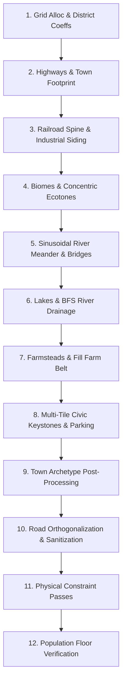

# FLOCK — Comprehensive Procedural World Generation Specification

This document is the authoritative engineering and design specification for procedural world generation, 1980s environmental art, and town rendering in **FLOCK** (`@flock/sim/src/mapgen.ts`, `gridRoads.ts`, `townRender.ts`, `palette.ts`, and `assetCatalog.ts`).

---

## 1. Core Principles & 1980s Small-Town Theme

### 1.1 Strict Determinism & Lockstep Invariance
FLOCK is a competitive multiplayer RTS running at 10 Hz lockstep across 4–100 players. World generation must be **bit-for-bit identical across all clients and servers**:
* **Seeded PRNG**: All randomness is derived from an explicit `RngState` using golden-ratio stride: `seed ^ (0x6d61_7067 + Math.imul(attempt, 0x9e37_79b9))`. `Math.random()` is strictly prohibited.
* **Pure State Functions**: Given an integer `seed`, `generateWorld(seed, width, height, opts)` generates identical flat typed arrays (`terrain`, `biome`, `district`, `lot`, `pop`, `owner`, `landmark`, `property`).
* **Fixed-Point Arithmetic**: Spatial and path calculations use integer and Q16.16 fixed-point math to avoid IEEE 754 floating-point divergence.

### 1.2 The 8px Visual Grammar
Rendering operates at a top-down pixel perspective with a fixed **8 pixels per tile** (`TILE_PX = 8`):
* **Single LOD Philosophy**: There are no zoom-dependent asset LODs. Zooming ($1\times$ to $4\times$) magnifies the procedural 8×8 pixel art.
* **Readable Silhouettes**: Every building, vehicle, tree, and resident is identifiable at 8px by silhouette, shadow, and color palette.
* **1px Panel Seams**: Adjacent modular building blocks use a 1-pixel shaded seam (`shade(c, 0.85)`) on shared boundaries. Storefront party-walls render 1px vertical division lines (`shade(wall, 0.5)`).

### 1.3 The 1980s American Small-Town Aesthetic ("Stranger Things" Era)
The environmental art and procedural morphology capture the nostalgic, slightly eerie charm of 1980s Americana (Hawkins, Indiana, ~1983–1986):
* **Urban Center**: Neoclassical red-brick courthouse/town hall square with manicured lawns and flagpole, flanked by Main Street commercial storefronts with retro awnings and vintage neon signs.
* **Residential Blocks**: Subdivisions of wood-clapboard and vinyl split-level/ranch houses with front porches, pitched roofs, driveways, garden sheds, chain-link fences, and above-ground pools.
* **1980s High School**: Low-slung red-brick campus with horizontal ribbon windows, outdoor bleachers, running track, and yellow school bus lot.
* **Working Countryside**: Sinusoidal meandering river with gravel bars and timber trestle bridges; rural farm belt with red gambrel barns, grain elevators, and tractor paths; coastal ocean shores with rolling surf.

---

## 2. Stage-by-Stage Generation Pipeline

The generation pipeline in `mapgen.ts` executes up to **5 retry attempts** (`attempt = 0..4`) with scale factor `rScale = 1 + attempt * 0.12`.



### Stage Details
1. **Grid Allocation**: Allocates flat parallel typed arrays (`terrain`, `lot`, `district`, `state`, `pop`, `owner`, `susceptibility`, `dissent`, `scarTicks`, `landmark`, `holdTicks`, `flags`, `biome`, `property`).
2. **Highways & Town Footprint**: Town center (`cx, cy`) placed within $\pm 4$ tiles of map center. Radius $r = \text{clamp}(16,\, \min(W, H) \times 0.32,\, \min(W, H) \times 0.28 \times rScale)$. 12-spoke boundary modulated by cosine interpolation, squashing N-S axis by $1.35\times$. Traces orthogonal street grid (`traceGridRoads`).
3. **Railroad Spine & Siding**: Straight line 5–9 blocks off highway minimizing road cuts. Industrial siding stamps `Lot.GrainElevator` and `Lot.Depot`.
4. **Biomes & Concentric Ecotones**: Mega-blobs or accent biome blobs stamped with organic multi-frequency noise.
5. **River Meander**: Harmonic sinusoidal meander ($a_1 \sin k_1 y + a_2 \sin k_2 y$) down the roomier map side. Column frozen at road crossings for square bridges. Downstream widening (1-wide $\to$ 3-wide $\to$ 4-wide). Upstream millpond weir (`Lot.Dam`).
6. **Lakes & Drainage**: BFS path carves 1-tile outlets connecting landlocked standing lakes to the river (except desert playas).
7. **Farms & Agriculture**: 4–6 farmsteads along rural roads (house, barn, silo, setback driveway, shelterbelt). `fillFarmBelt` packs rural land with $11 \times 9$ coarse lattice cells of $6\times 6$ parcel fields.
8. **Civic Keystones & Parcels**: Stamped multi-tile footprints with integrated paired parking lots.
9. **Town Archetype Adjustments**: Archetype-specific overrides (`farm`, `oceanside`, `desert`, `mountain`, `lakeside`).
10. **Road Sanitization**:
    * `orthogonalizePaths`: Bridges diagonal road/dirt contacts.
    * `extendEdgeRoads`: Extends streets ending within 8 tiles of map border to the boundary.
    * `connectRoadComponents`: Multi-source BFS corridor connection eliminates orphan road islands.
    * `pruneRoadStubs` & `pruneAllDeadEnds`: Recursively eliminates dangling dead-end spurs.
11. **Physical Constraint Enforcement**:
    * `enforceZoningBuffer`: $\ge 6$ tile Euclidean/Chebyshev buffer between Industrial and sensitive institutions (Schools, Churches).
    * `enforceCivicParkingAdjacency`: 100% of civic/commercial anchors must possess an adjacent road-touching `Lot.Parking` tile (5 fallback passes).
    * `enforceHydrologicalSetback`: $\ge 1$-tile grass buffer between water and all non-water-exempt buildings/farms.
    * `enforceRoadFrontage`: Demotes interior lots without orthogonal road access to yards/gardens.
    * `infillToFloor`: Upgrades empty yards to modest homes until population floors hold.
12. **Verification Check**: Verifies populated tiles $\ge 640$ and souls $\ge 2{,}900$ (on $96\times 96$). Retries with larger $rScale$ if floors fail.

---

## 3. Biomes & Concentric Ecotones

### 3.1 Biomes
* **Temperate (0)**: Rolling green pastures, scattered deciduous copses, loamy soil.
* **Desert (1)**: Ochre sand, sandstone ridges, dry sagebrush, saguaro cactus stands, date palm oases.
* **Forest (2)**: Deep damp loam floor (`#3a5928`), dense evergreen pines, fallen logs, mossy stone boulders.
* **Autumn (3)**: Golden-rust soil floor (`#c9a054`), blazing scarlet, burnt orange, and golden canopies.
* **Ocean (4)**: Saltwater coastline, dunes, sand beach strip, sea docks, lighthouse promontory.

### 3.2 3-Ring Ecotone Transitions & Edge Bleed
Transitions between biomes grade across **3 concentric rings** using deterministic per-pixel hashing (`h = pixHash(gx, gy)`):
* **Desert**: Ring 1: heavy sand (`h % 3 === 0`); Ring 2: sparse sand/scrub (`h % 6 === 0`); Ring 3: sparse scrub (`h % 12 === 0`).
* **Forest & Autumn**: Loam/rust ground blended at Ring 1 (`h % 2 === 0`), Ring 2 (`h % 4 === 0`), Ring 3 (`h % 8 === 0`).
* **`naturalEdgeBleed`**: Woods and lakes bleed sub-tile noise-modulated fringe into neighboring grass based on 1-D value noise (`reach = 1 + valueNoise * 3.2`).

---

## 4. The Five Town Archetypes

| Archetype | Dominant Geography | Signature Assets | Keystone Rules |
| :--- | :--- | :--- | :--- |
| **`farm`** | Temperate prairie, meander river, farm belt | Grain Elevator, Silo, Red Gambrel Barn, Depot, Farmhouse | Default baseline. Skips archetype pass for byte-level determinism. |
| **`oceanside`** | Ocean coastline along roomier map edge, 2-tile sand beach, estuary river mouth | Lighthouse (north of pier), Cannery + fish docks (south of pier), 4-tile highway pier | **Grain elevator is eradicated and replaced with a second Cannery**. Roads terminating in sea are trimmed. |
| **`desert`** | Dominant Desert biome across map; temperate oasis in town center | Saguaro stands, dry wash arroyo, date palms at water, adobe houses with earthen roofs | Farmland and crops are strictly prohibited. Desert lakes are endorheic playas (no river outlet channel carved). |
| **`mountain`** | Dense Forest valley walled in by 16 heavy conifer stands | 2-tile Sawmill on rail line with 1-tile dirt log yard | Farmland climbing into forest biome is automatically reverted to timber woods/grass. |
| **`lakeside`** | Massive irregular lake blob ($R = 17\text{--}21$) directly abutting town | Resort shore: $\ge 5$ cabins (`Lot.None`, Suburbs pop 3), $\ge 3$ Docks, boat ramp | Giant water body ($\ge +250$ lake tiles over farm baseline); hydrological setback strictly enforced around resort shoreline. |

---

## 5. Road Network Architecture (`gridRoads.ts`)

* **Strict Orthogonality**: All streets travel strictly along cardinal axes ($N, S, E, W$). **Zero diagonals.**
* **Street Hierarchy**:
  1. *2-Lane Highway / Main Street*: Two painted rows (`highwayY`, `highwayY + 1`) spanning full map width ($x = 0 \dots W-1$).
  2. *County Route*: Vertical artery (`highwayX`) spanning full map height ($y = 0 \dots H-1$).
  3. *Avenues & Streets*: Stepped outward from arteries with organic jitter (5–6 lots downtown, 6–8 lots at fringe).
  4. *Mid-Block Lanes*: Blocks with gap $\ge 7$ rows get a 1-tile residential lane through the center.
  5. *Cul-de-Sacs*: 2–3 stub courts ending in a dead-end bulb ringing residential blocks.
  6. *Country Roads*: Section-line continuations out to map edges with 40% probability of 2–5 tile jogs.
  7. *Alleys*: Dirt lanes behind Main Street commercial lots at $hy - 2$ and $hy + 3$.
  8. *Sidewalks*: 1px perimeter concrete sidewalks (`#b8b2a5`); Old Town features red brick sidewalks (`#8c685c`); curb cuts (`shade(asphalt, 0.85)`) fronting parking lots.

---

## 6. Recognizable 1980s Civic Landmarks & Multi-Tile Parcels

### 6.1 Landmarks (`Landmark` Enum)
* **Town Hall (3)**: Centered at Downtown core (`cx, cy`). Brick courthouse with stone steps, bell cupola, and municipal flagpole.
* **Megachurch (2)**: Town edge (`cx + r - 2, cy + 3`). Stepped stone facade, stained-glass arch window, and cross belfry. Primary Revelation objective.
* **County Fairground (4)**: Opposite town edge (`cx - r + 2, cy - 3`). Grandstands, exhibition rings, and festival pavilions.
* **Radio Broadcast Tower (1)**: Elevated countryside hill ($15\% W, 15\% H$). Steel lattice transmission tower with flashing red aircraft warning beacon.
* **Municipal Water Tower (5)**: Countryside ($85\% W, 85\% H$). Spherical steel tank on trestle legs with faded high-school graduation graffiti.

### 6.2 Recognizable 1980s Multi-Tile Building Footprints
* **1980s High School**: $2\times 2$ low red-brick building $+ 2\times 1$ bus parking $+ 2\times 2$ football field with bleachers (20 workers).
* **Elementary School**: $2\times 2$ building $+ 2\times 1$ parking $+ 1\times 2$ playground with swings and jungle gym (16 workers).
* **1980s Supermarket**: $2\times 2$ grocery store with sloped entrance awning $+ 2\times 1$ asphalt parking lot (14 workers).
* **Town Police / Sheriff Station**: $2\times 1$ station with radio aerial $+ 2\times 1$ cruiser parking with bubble-light cars (6 workers).
* **Classic Cinema / Arcade**: $2\times 2$ theater with illuminated night marquee $+ 2\times 1$ parking (10 workers).
* **Drive-In Diner**: $1\times 1$ chrome/checkered diner $+ 2\times 1$ angled drive-in carports.
* **Gas Station**: $1\times 1$ service shop $+ 2\times 1$ pump canopy island with boxy 1980s pump housings.
* **Industrial Rail Depot & Elevator**: $2\times 1$ brick depot with timber platforms and $2\times 1$ concrete grain elevator silos on rail siding.

### 6.3 Physical Invariants
* **Zoning Buffer**: Enforces minimum **6-tile buffer** between Industrial lots and sensitive institutions (Schools, Churches).
* **Parking Adjacency**: 100% of civic/commercial anchors have an adjacent `Lot.Parking` tile touching a road.
* **Hydrological Setback**: Enforces **$\ge 1$-tile grass buffer from water** for all non-exempt buildings. Water-exempt lots: `Parking`, `Dock`, `Depot`, `Dam`, `Lighthouse`, `Cannery`, `Sawmill`.

### 6.4 Urban Placement Grammar (Resolving Generation & Orientation Flaws)
To eliminate past issues with awkward, unrealistic asset placement, the generator enforces strict urban planning grammar:
1. **Street Frontage & Door Orientation**:
   * Every building has a defined front, rear, and sides.
   * Front doors, porches, and retail display windows **must face the nearest road/sidewalk**. Structures never generate backwards (e.g. back porch facing Main St) or facing into a neighboring blind wall.
2. **Driveways & Curb Cuts**:
   * Residential garages and commercial parking aprons must orthogonally connect to streets via dedicated driveway paving and 1px sidewalk curb cuts (`shade(asphalt, 0.85)`).
3. **Cohesive Perimeter Blocks & Private Backyards**:
   * Backyards belong behind residential structures. Houses form cohesive outward-facing perimeter rings enclosing private interior green spaces (fenced yards, vegetable patches, garden sheds, clotheslines, or circular above-ground pools) rather than arbitrary checkerboards.
4. **Zoning Integrity & Separation**:
   * Eliminate unrealistic juxtaposition: commercial retail stays clustered on Main Street and highways; residential homes form calm cul-de-sacs and avenues; noisy industrial yards (sawmills, warehouses, gravel pits) are strictly segregated along the railroad on the downwind edge of town.
5. **Civic Institution Grounding**:
   * The High School campus is placed as a unified compound: main building, sports field, and yellow bus loop adjacent to an arterial road.
   * Town Hall anchors a central public square/park with monument, flagpole, and stone walkways.

---

## 7. Agriculture & Rural Working Landscapes

* **Field Parcels**: Anchored on rural roads outside town ($r + 6$), bounded by 1-tile grass shoulders and baulks. Organized into $6\times 6$ tile parcels.
* **5 Crop Varieties** (hashed per parcel coordinate):
  0. **Golden Wheat**: `#d4b247` base / `#f0d675` row
  1. **Corn Rows**: `#54802a` base / `#e6c832` row
  2. **Canola Blossom**: `#e6c832` base / `#62a838` row
  3. **Rich Soybeans**: `#4f8c2e` base / `#3a6921` row
  4. **Dark Soil Furrows**: `#6b523b` base / `#4e3b29` row
* **Sub-Tile Tractor Dirt Paths**: 2px wide dark dirt tracks (`#483726`, winter `#5e5246`) at parcel boundaries simulating tractor ruts connecting farmsteads to rural roads.
* **Seasonal Agricultural Details**:
  * *Fall*: Golden hay bales (`#d8c88e`) dot fallow fields; barns spawn adjacent hay stacks.
  * *Spring*: Brown soil with vibrant green young sprouts (`#82cf3c`).
  * *Winter*: Frozen snow ridges over dark earth tractor ruts.
* **Wheel-Line Irrigation**: Silver sprinkler pipe (`#d8dee2`) with two wheels (`#8a9399`) spanning fields.
* **Pastures & Orchards**: Fenced pastures with grazing livestock (dairy cows `#ffffff`, brown cows `#8b5a2b`, horses `#7a4a2a`) and orchards with seasonal fruit/blossoms.

---

## 8. Environmental Rendering, Variants & Micro-Animations (`townRender.ts`)

### 8.1 The 1980s Vehicle Fleet
Vehicles on highways, town streets, and parking lots render distinct 1980s profiles at 8px:
* **Wood-Paneled Station Wagon**: Extended body with brown wood-grain trim (`#7a4a2a`) along the sides and roof luggage rack.
* **Boxy Sedans**: Chevy Caprice / Ford LTD profile with square chrome grille and defined hood and trunk decks.
* **Square-Body Pickups & Blazers**: High-clearance cab, open rear bed with optional tool chest, two-tone paint.
* **Police Cruisers**: White doors, black chassis, and rooftop flashing bubble/gumball emergency beacon (`#ff3333` / `#3366ff`).
* **Yellow School Bus**: 2-tile extended yellow body (`#f0b53e`) with dark window strip and black rub rails.
* **Recruitment & Delivery Vans**: Boxy 1980s Dodge Ram Van / Chevy G20 with custom faction side graphics.
* **BMX Bicycles**: Micro 2-pixel town kids riding along residential sidewalks.

### 8.2 Visual Asset Variants (Eliminating Copy-Paste Uniformity)
To prevent the town from looking like a cloned stamp sheet, assets feature deterministic visual variants rolled via tile coordinate hashes:
* **Residential Architecture Variants**:
  - *Split-Level*: Attached side garage, driveway, and staggered rooflines.
  - *Traditional Ranch*: Long horizontal profile, covered front porch, red-brick chimney.
  - *Two-Story Colonial*: Gabled roof, upper dormer windows, central front door.
  - *Modest Cottage*: Compact footprint with flower boxes, garden shed, or circular above-ground pool.
  - *Color Palette Diversity*: Clapboard siding varies across cream white, pale yellow, dusty blue, sage green, and brick red.
* **Commercial Storefront Variants**:
  - Fabric awnings in alternating colors (forest green, burgundy, navy, mustard).
  - Roof parapets, decorative brick cornices, and variable neon sign positions.
* **Vehicle Palette Diversity**: Sedans and pickups render in authentic 1980s automotive colors (rust red, midnight blue, desert tan, primer gray, forest green, two-tone).
* **Tree Species Mix**: Mature spreading oaks, conical pines, pale birch stands, and seasonal flowering dogwoods.

### 8.3 Dynamic Micro-Animations (Living Town Environment)
The world is never purely static. Deterministic procedural micro-animations (driven by `sim.tick` / `frameTick`) bring Mundane Falls to life:
1. **Hydrological Flow**:
   - River reach water ripples with drifting glints moving downstream.
   - Ocean coastline surf breaks rhythmically in a 4-frame swell of white foam on sand beaches.
   - Millpond dam weir sprays cascading white water foam.
2. **Vehicle & Infrastructure Flashing Beacons**:
   - Police cruisers: Alternating red and blue emergency rooftop strobe pulses (`(tick >> 2) % 2 === 0 ? C.strobeRed : C.strobeBlue`).
   - School buses: Blinking amber hazard roof flashers.
   - Radio Broadcast Tower: Slow 2-second breathing red aviation warning beacon atop the steel lattice.
   - Commercial neon: Subtle intermittent flicker on the diner and cinema marquee.
3. **Living Town Entities & Smoke**:
   - Winter & Fall Chimney Smoke: Translucent gray smoke wisps rising and drifting from residential chimneys.
   - Pasture Livestock: Grazing dairy cows and horses with periodic tail swishes and head-bob feeding motions.
   - Pedestrians & BMX Kids: Alternating 2-pixel stepping feet and spinning bike wheels traversing sidewalks.

### 8.4 Seasonal Palettes
* **Spring**: Vibrant green meadow (`#6da344`), flowering cherry/dogwood blossoms (`#ffd0e8`), tilled brown soil with green sprouts (`#82cf3c`), clean sidewalks.
* **Summer**: Deep warm green meadow (`#829c5e`), dark tree canopies (`#2d5a27`), full crop rows, ripe fruit.
* **Fall**: Golden rust meadow (`#a49e60`), scarlet/orange/gold maple canopies (`#b06f33`, `#c0a052`, `#96473a`), tan crop stubble (`#baa57c`), hay bales, fallen leaf clusters along curbs.
* **Winter**: Pure white snow meadow (`#eef4f8` / `#ffffff`), snow-covered roofs with north-facing accumulation, bare brown tree branches with snow caps (`#5c4c38`, `#ffffff`), frozen light-blue ice sheets (`#aed5e8`), snowmen in residential yards.

### 8.3 Diurnal Lighting Filters
* **Day**: Unmodified RGB baseline.
* **Dawn**: Amber warmth: $\text{RGB} = [\min(255, R \times 1.12 + 15),\, \min(255, G \times 0.95 + 8),\, \min(255, B \times 0.82)]$.
* **Dusk**: Violet twilight: $\text{RGB} = [\min(255, R \times 1.05 + 10),\, \min(255, G \times 0.82 + 5),\, \min(255, B \times 1.12 + 10)]$.
* **Night**: Moonlight mask: $\text{RGB} = [R \times 0.22,\, G \times 0.32,\, B \times 0.55]$.
* **Luminous Glow Bypass (`isLit`)**: Streetlights, vehicle headlights, illuminated storefronts, and lit residential windows (`C.windowLit = #ffd76a`) **completely bypass diurnal darkening**, glowing at full brightness in the dark.

---

## 9. Verification & Invariant Audit Protocol

Automated test suites in `packages/sim/test/` (`mapgen.test.ts` and `archetypes.test.ts`) assert **10 core invariants across 75 consecutive worlds** (5 archetypes $\times$ 15 seed families):

1. **Determinism**: Identical seed produces bit-identical buffers and state hashes. Replay snapshot roundtrip is 100% invariant.
2. **Road Orthogonality**: 0 unbridged diagonal road contacts (`cornerOnly === 0`) and 0 isolated road pixels (`isolated === 0`).
3. **World Naming**: Every world generates a valid Faker town name ($\ge 3$ chars), $\ge 10$ named street segments, and guaranteed `Main Street`.
4. **Population Floors**: $96\times 96$ competitive worlds guarantee $\ge 640$ populated citizen tiles and $\ge 2{,}900$ residents.
5. **Frontage Guarantee**: 100% of residential homes (pop $\ge 3$) maintain orthogonal access to a road or path (0 orphan homes).
6. **Civic Guarantee**: 100% presence of keystone civic buildings: Elementary School, High School, Sheriff, Supermarket, Church, Fire Station, Gas Station, Warehouse, Bank, Post Office, Factory, Cinema, Library, Diner, Railroad, Grain Elevator, and Depot.
7. **Parking Adjacency**: 100% of civic/commercial anchors have an adjacent `Lot.Parking` tile touching a road.
8. **Hydrological Setback**: 0 residents living on water; no buildings on water except water-exempt lots; 1-tile grass buffer between water and crops/buildings.
9. **Archetype Signature Guarantees**:
   * Oceanside: $\ge 1500$ Ocean biome tiles, $\ge 1$ Lighthouse, $\ge 1$ Cannery, exactly 0 Grain Elevators.
   * Mountain: $\ge 1500$ Woods tiles, $\ge 2$ Sawmill tiles on rail line, 0 farmland in Forest biome.
   * Lakeside: $\ge +250$ lake tiles over farm baseline, $\ge 3$ Docks.
   * Desert: $\ge 4000$ Desert biome tiles, $\ge 90\%$ of populated tiles on temperate oasis ground.
10. **Rural Working Landscape**: Cultivated farmland $> 20\%$ of rural land; drainage basin $> 200$ water tiles with river/lake connectivity.

Execute invariant audit:
```bash
npm test
```
All 135 tests must report `100% Invariants Met` and `Violations: 0`.
