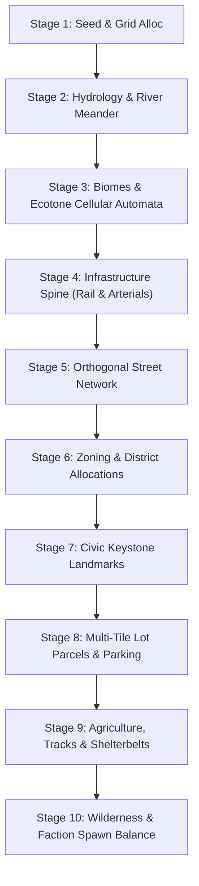

# FLOCK — Comprehensive Procedural World Generation Specification

This document is the authoritative engineering and design specification for the procedural world generation and environmental rendering engine in **FLOCK** (`@flock/sim/src/mapgen.ts`, `gridRoads.ts`, `townRender.ts`, and `palette.ts`). It outlines the mathematical principles, generation pipeline, biome ecosystems, urban layout heuristics, environmental systems, and verification protocols.

---

## 1. Core Architecture & Mathematical Foundations

### 1.1 Strict Determinism & Lockstep Invariance
FLOCK is a browser-first competitive multiplayer RTS. To achieve sub-100ms lockstep synchronization across 8–100 players without sending heavy state frames over the network, **world generation must be 100% deterministic**:
* **Seeded PRNG**: All random choices are derived from an explicit `RngState` (seeded via `SplitMix32` / Xoroshiro). `Math.random()` is strictly prohibited as its V8/SpiderMonkey floating-point implementations vary across runtimes.
* **Pure State Functions**: Given an integer `seed`, `generateWorld(seed, width, height)` generates bit-for-bit identical tile arrays (`terrain`, `biome`, `district`, `lot`, `pop`, `owner`).
* **Fixed-Point Arithmetic**: Coordinate calculations, pathfinding cost calculations, and distance metrics use fixed-point or integer arithmetic (Q16.16) to avoid IEEE 754 floating-point divergence.

### 1.2 The 8px Visual Grammar
The game renders in a top-down pixel perspective at a fixed **8 pixels per tile**:
* **Single LOD Philosophy**: There are no zoom-dependent asset LODs or high-res texture packs. Zooming magnifies the procedural 8×8 pixel art.
* **Readable Silhouettes**: Every building, vehicle, tree, and resident must be instantly identifiable at 8px by its silhouette, shadow, and color palette.
* **Micro-seam Delineation**: Adjacent modular building blocks use a 1-pixel shaded seam (`shade(c, 0.85)`) on shared boundaries. This creates realistic architectural paneling and prevents tall structures from merging into flat blobs.

---

## 2. Stage-by-Stage Generation Pipeline

The generation pipeline executes in 10 sequential, deterministic stages:



### Stage 1: Seed & Grid Allocation
* World dimensions default to $96 \times 96$ tiles ($768 \times 768$ px) for standard matches, scaling up to $192 \times 192$ or $256 \times 256$ for mass multiplayer.
* Flat typed arrays allocate `terrain: Uint8Array`, `biome: Uint8Array`, `district: Uint8Array`, `lot: Uint8Array`, and `pop: Uint16Array`.

### Stage 2: Hydrology & River Meandering
* **River Curve**: Generated using a continuous mathematical spline driven by harmonic noise, cutting across the map from edge to edge.
* **Stone & Gravel Shores**: River and lake edges generate 1-pixel buffer fringes of stone (`#8c867a`) and damp sand gravel (`#ad9c82`), preventing unnatural water-to-grass clipping.
* **Riparian Bias**: Mature woodland and willow stands naturally cluster within 8 tiles of waterways. Forest placement strictly respects water proximity before claiming dry farmland.
* **Bridges**: Where orthogonal roads cross water tiles, procedural wooden or stone trestle bridges are generated with guardrails and shadow pier pilings.

### Stage 3: Biome Distribution & Cellular Automata
* Base terrain noise uses multi-frequency octave sampling with domain warping to produce smooth, non-rectilinear biome borders:
  * **Temperate Plains** (`Biome.Temperate`): Rolling grassy pastures, scattered deciduous copses, and loamy fertile soil.
  * **Pine Forest** (`Biome.Forest`): Deep forest green canopy floor (`#3a5928`), dense evergreen pines, fallen logs, and mossy stone boulders.
  * **Desert Scrub** (`Biome.Desert`): Arid ochre sand (`#d9ba82`), sandstone ridges, dry sagebrush, and sparse saguaro cacti.
  * **Autumn Woodlands** (`Biome.Autumn`): Golden-rust soil floor with deciduous groves that blaze in red, orange, and gold during Fall.
  * **Mountain Foothills** (`Biome.Mountain`): Elevated granite cliffs, scree slopes, and alpine pine clusters.
  * **Oceanside / Coastal** (`Biome.Oceanside`): Saltwater coastline with breaker shoals, dunes, and lighthouse promontories.
* **Cellular Smoothing**: 3 passes of cellular automata smooth biome noise, eliminating isolated 1-tile speckles while preserving ecotones.
* **Spillover Prevention**: Forest stands are strictly prevented from bleeding into Desert biomes; cacti only spawn sparsely via dedicated distribution loops.

### Stage 4: Infrastructure Spine (Railroad & Main Arterials)
* **Railroad Line**: A straight, continuous railway cuts across the map, anchored by wooden ties, steel rails, and gravel ballast.
* **Rail Siding & Industrial Spur**: A turnout switch branches off the main rail line into an industrial rail siding, serving the **Grain Elevator** and **Freight Depot Station**.
* **Crossbucks**: Railroad-street intersections automatically generate white diagonal crossbuck signals and warning road markings.

### Stage 5: Orthogonal Street Network
* **Strict Orthogonality**: All streets travel strictly along cardinal directions ($N, S, E, W$). Diagonal streets are prohibited to maintain clean pathfinding grids.
* **No Orphan Households**: Every residential lot and institution maintains guaranteed road frontage or footpath connection.
* **Street Hierarchy**:
  * *Highways (Main Arterials)*: 2-tile wide asphalt with painted yellow double-center lines (`#e6c832`).
  * *Town Streets*: 1-tile wide asphalt with white dash stripes (`#ffffff`) and concrete sidewalks (`#b8b2a5`).
  * *Lanes & Alleys*: Narrow access routes servicing rear backyards and industrial bays.

### Stage 6: District Zoning & Urban Morphology
* **Downtown Core (District 3)**: Centered around the map centroid ($cx, cy$). Features continuous storefronts, high population density, multi-story brick facades, and concrete plazas.
* **Commercial Strip (District 6)**: Extends outward along highways; features diners, gas stations, supermarkets, and motel rows.
* **Residential Suburbs (District 1)**: Cul-de-sacs and grid blocks with detached single-family homes, neat green lawns, driveways, picket fences, and backyard vegetable gardens.
* **College Quad (District 2)**: Brick lecture halls, libraries, paved walking paths, manicured lawns, and shaded commons.
* **Industrial Lobe (District 7)**: Warehouses, auto repair garages, gravel yards, corrugated steel sheds, and smokestacks adjacent to the railway.
* **Outskirts / Trailer Park (District 5)**: Gravel lanes, manufactured trailer homes, propane tanks, and utility sheds on the urban periphery.

### Stage 7: Civic Keystone Landmarks
Every generated world guarantees placement of keystone civic institutions:
1. **Megachurch**: The primary Revelation win-condition monument. Centrally located with radial road access.
2. **Town Hall**: Neoclassical civic anchor with columned portico and municipal flag.
3. **Sheriff's Station**: Generates an active Heat-cooling aura over nearby districts.
4. **Radio Broadcast Tower**: High-elevation steel lattice transmission tower broadcasting cult sermons.
5. **Municipal Water Tower**: Spherical steel tank on trestle legs providing defensive vision.
6. **County Fairground**: Pavilions, agricultural show rings, and festival tents.
7. **Classical Library**: Stone facade, grand steps, and pediment roof.
8. **Historic Chapel**: Steeple, arched belfry window, and stained glass.
9. **Schoolhouse**: Red brick exterior, white bell tower, and playground.

### Stage 8: Multi-Tile Lot Parcels & Paired Parking
* Large institutions (Supermarkets, High Schools, Warehouses, Factories) are placed as coherent **multi-tile footprints** ($2\times 1$, $2\times 2$, or $3\times 2$).
* **Paired Parking Lots**: Commercial lots automatically claim adjacent road-facing tiles as asphalt parking aprons complete with white bay markings and parked vehicles.
* **Hydrological Setback**: Civic and commercial structures (except Docks and Depots) enforce a 1-tile setback from water bodies to maintain realistic town planning.

### Stage 9: Agriculture, Tracks & Shelterbelts
* **Agricultural Fields**: Farmed countryside is organized into coherent $6\times 6$ tile parcels.
* **5 Crop Varieties**:
  1. *Golden Wheat*: Rich honey wheat rows with golden glints.
  2. *Corn Rows*: Deep green corn stalks alternating with tilled shadows.
  3. *Canola Blossom*: Bright yellow flower blankets.
  4. *Rich Soybeans*: Compact verdant leafy rows.
  5. *Tilled Furrows*: Dark loamy soil ridges.
* **Sub-Tile Agricultural Dirt Paths**: 2-pixel wide dark dirt tracks (`#483726`) run along parcel boundaries, realistically modeling tractor tracks connecting farmsteads to rural highways.
* **Hay Bales**: Rolled straw bales dot harvested fields exclusively during the Fall season.
* **Irrigation Pivots**: Silver wheel-line sprinkler pipes stretch across selected fields.
* **Orchards & Pastures**: Neat rows of fruit trees (showing seasonal blossoms or fruit) and fenced pastures with cattle and stock tanks.

### Stage 10: Wilderness & Faction Spawn Balance
* **Equidistant Spawns**: Competing player factions spawn in open country/forest margins equidistant from the Downtown core.
* **Spawn Viability**: Every spawn zone guarantees $\ge 600$ neutral citizen tiles within 20 tiles, access to at least two district types, and no immediate landmark obstruction.
* **Commune Compounds**: Faction compounds feature procedural visual upgrades across stages 1 through 5 (from pitch tents to fortified chapels, bus depots, and defensive walls).

---

## 3. Dynamic Environmental Systems

### 3.1 The Four Seasons

The renderer dynamically shifts color palettes and sprite geometry based on the `season` parameter:

| Season | Meadows & Ground | Tree Canopies & Woodlands | Agricultural Fields | Roofs & Architecture |
|---|---|---|---|---|
| **Spring** | Light vibrant green (`#6da344`) | Cherry & peach pink blossoms (`#ffd0e8`) | Tilled brown soil with young green sprouts (`#82cf3c`) | Standard materials; clean washed sidewalks |
| **Summer** | Rich warm green (`#829c5e`), dark rich lawns | Deep forest green (`#2d5a27`) with sunlit rims | Ripe gold wheat, tall corn, blooming canola | Sun-warmed tiles with sharp drop shadows |
| **Fall** | Golden rust floor (`#a49e60`) | Scarlet red, vivid orange, and rich golden canopies | Harvested tan stubble (`#baa57c`) with golden hay bales | Crisp autumn tones; fallen leaf speckles |
| **Winter** | Pure white snow cover (`#eef4f8` / `#ffffff`) | Bare wood branch silhouettes with white snow caps | Snow-covered ridges; frozen dark earth tractor ruts | White snow caps on roofs; frozen ice-blue waterways (`#aed5e8`) |

*Rule*: Red, orange, and yellow foliage renders **strictly in Fall**, preserving fresh spring and summer greens throughout the rest of the year.

### 3.2 Diurnal Lighting Cycles (Time of Day)

Pixel output is processed through a deterministic lighting shader:
* **Dawn**: Soft rose and warm peach ambient color shift ($+15\%$ red, $+8\%$ green, $-5\%$ blue).
* **Day**: Pure natural sunlight; baseline balanced contrast.
* **Dusk**: Deep golden twilight with long-cast purple shadow filtration.
* **Night**: Cool moonlit blue mask ($0.45\times$ base brightness with deep blue cast).
  * **Luminous Glow Bypass**: Streetlights, vehicle headlights, illuminated storefronts, and lit residential windows (`C.windowLit`) bypass the night multiplier, shining with warm golden radiance against the dark.

---

## 4. Verification & Audit Protocols

Every iteration of the world generator must pass the automated verification test suite:

### 4.1 Invariant Checklist
1. **Determinism**: Identical seed generates identical state hash (`test/mapgen.test.ts`).
2. **Connectivity**: 100% of residential tiles maintain orthogonal street or path access. Zero orphan houses.
3. **Population Floors**: Standard $96\times 96$ competitive worlds must contain $\ge 640$ populated tiles and $\ge 2,900$ residents.
4. **Road Integrity**: Streets are strictly orthogonal. No diagonal connections, no disconnected single-pixel roads.
5. **Civic Guarantee**: Megachurch, Town Hall, Sheriff, Grain Elevator, Railroad, and Depot Station must be successfully planted.
6. **Multi-Seed Audit**: The automated audit runner (`mapgen.test.ts`) verifies 75 consecutive worlds across 5 town archetypes (Farm, Oceanside, Desert, Mountain, Lakeside) across 15 seed families with zero invariant violations.

### 4.2 Executing Invariant Checks
```bash
npm test
```
All 131 tests and the 75-world audit must report `100% Invariants Met` and `Violations: 0`.
